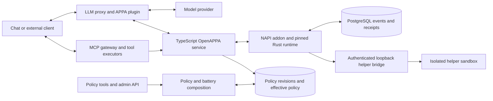
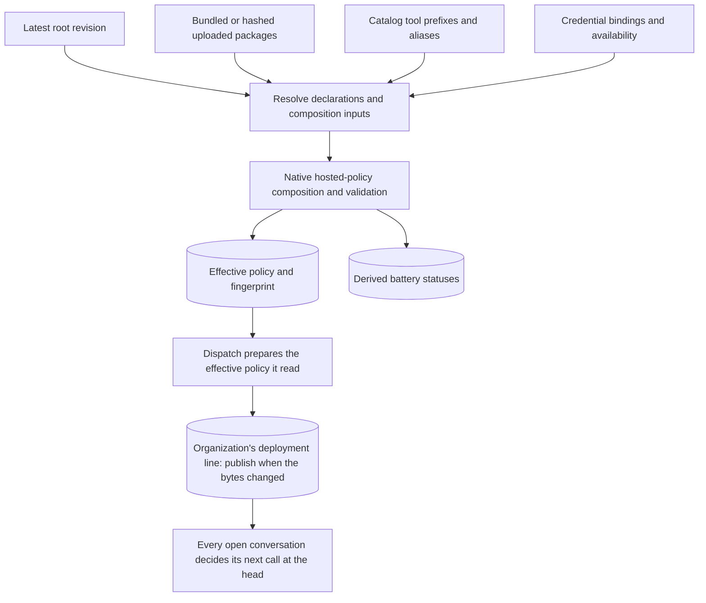
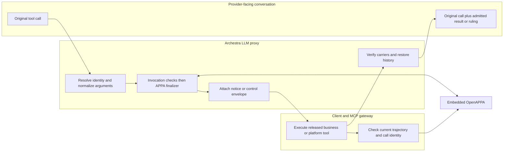
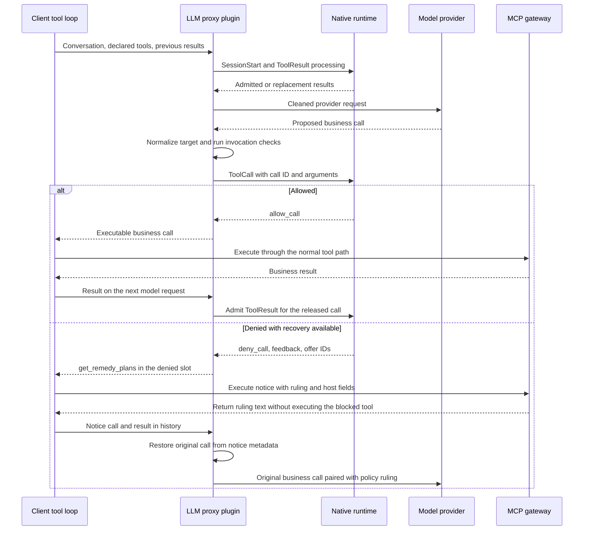
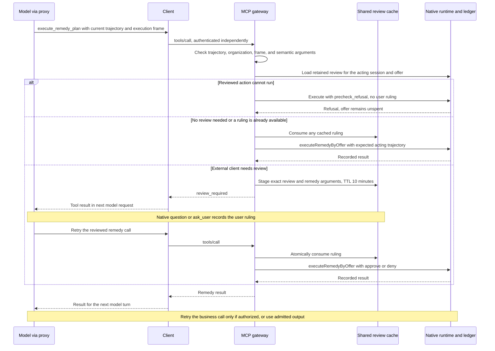
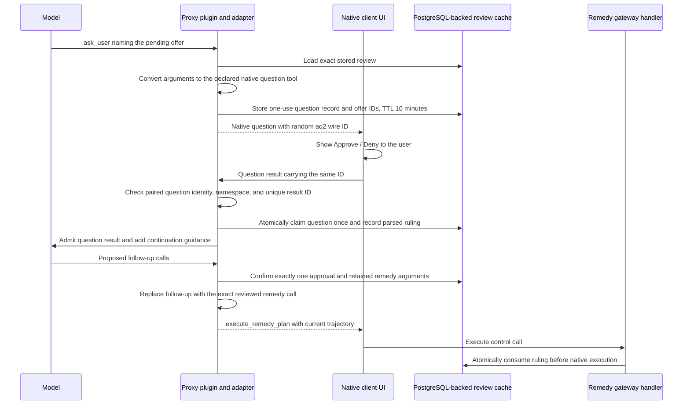
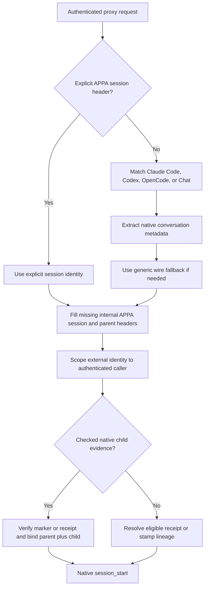
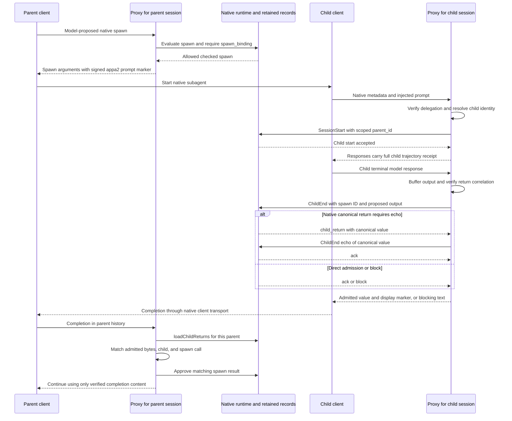
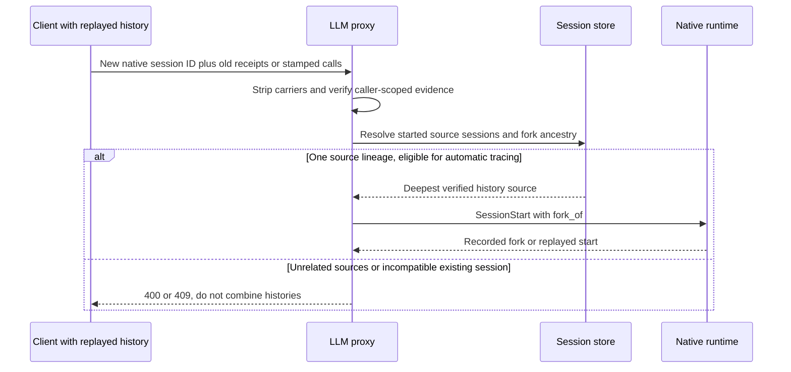
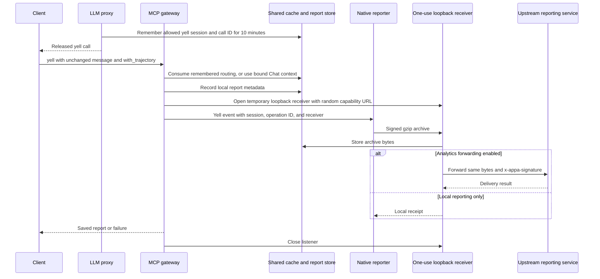

# Archestra and OpenAPPA

OpenAPPA evaluates tool calls and tool results at the LLM proxy. The proxy identifies sessions from client headers or an explicit `X-Appa-Session-ID`. External client sessions scope to the authenticated credential (`user:<id>`, `app:<id>`, or `virtual-key:<id>`). This prevents callers from guessing another user's session ID. Two MCP tools manage policy remedies: `archestra__get_remedy_plans` and `archestra__execute_remedy_plan`.

The runtime keys session state by session ID. Internal requests over loopback share session IDs. Chat requests require an authenticated user who owns the conversation. External requests require platform credentials. Uncredentialed loopback forms the platform trust boundary. Requests without a session ID fall back to a shared identity per credential and agent (`<caller-id>@<agent-id>`), which couples their histories and turn approvals.

This guide explains Archestra's integration rather than OpenAPPA policy syntax. The native addon uses the OpenAPPA revision pinned in [`Cargo.toml`](../platform/archestra-rs/openappa-rs/Cargo.toml). Examples use the default `archestra__` tool prefix; client labels and branding can change it on the wire.

Protocol jump links: [call rewriting](#tool-calls-and-results), [remedy execution](#remedies), [user questions](#ask_user-and-native-elicitation), [session and child markers](#protected-session-markers), and [yell reporting](#yell-and-diagnostic-tools).

The pin records the dependency version, not a promise about later releases. Check [`Cargo.toml`](../platform/archestra-rs/openappa-rs/Cargo.toml) for the current OpenAPPA pin. Review this guide when that pin or the host protocols change.



The proxy, connected clients, and user are trusted. Model output and external tool content remain untrusted. Adapters obtain execution identity from client metadata, not from model-written arguments or text.

## Startup configuration

OpenAPPA is available on every deployment. Its UI, proxy plugin, and policy API do not depend on `ARCHESTRA_BETA`.

The deployment-wide guardrail setting controls policy enforcement for the whole deployment. It defaults to off and lives in the database (`guardrails_deployment.enabled`). Turn this database switch on to enforce policies. Each request reads the database switch, so replicas do not depend on local process state. The plugin list alone does not activate enforcement.

Policy editing and GitHub sync stay available while enforcement is off. The OpenAPPA editor stores policy revisions in PostgreSQL. Toggling the database switch takes effect immediately without a restart.

Without enforcement, the proxy and the MCP gateway apply no tool-call guardrails. They still refuse calls to tools that the request does not declare.

| Boundary | Beta off | Beta on, switch off | Both on |
| --- | --- | --- | --- |
| Incoming tool results | Passed through | Passed through | APPA admission and saved output |
| Outgoing calls | Undeclared-tool check | Undeclared-tool check | Undeclared-tool check, then APPA decision |
| Denied call | Undeclared-tool refusal | Undeclared-tool refusal | Notice call carrying APPA ruling and remedies |
| Session header | No APPA wiring | Observes unenforced sessions | Stable conversation identity and trajectory |
| Runtime MCP tools | Not advertised implicitly | Notice, remedy, and peer tools not advertised implicitly | Notice, remedy, and peer tools advertised |
| Runtime | No proxy enforcement | Unenforced-session observation | Lazy native init, call reservation, receipt commits |

The HTTP API and policy tools share validation and revision checks. Edits compile without calling external services. The next protected call publishes the latest saved revision as the organization's next policy revision. Every open conversation decides its next call under it, as new ones do (see [Policy revisions](#policy-revisions)).

The editor accepts `[policy]`, `[aliases]`, and URL bindings in `[externals]`. It only permits battery declarations in `include` entries. Any other include, local command, or runtime setting causes a validation failure. For now the text names no credentials: validation refuses a `[credentials]` table and a root `token_env`, and every save path (UI, agent tools, GitHub sync) runs that check. Battery credentials are stored bindings (`openappa_credential_bindings`), set from the Batteries page or `bind_guardrails_credential`. This is a temporary rule until credentials and Git sync are designed together.

Revision `0` is an unsaved starter template (`initialPolicy()` in [`guardrails-policy.ts`](../platform/backend/src/services/guardrails-policy.ts)). It includes the bundled Archestra, coding and Claude Code batteries, an Archestra server alias under `[aliases.mcp]`, a `claude-code = ["archestra"]` host alias that rebinds the Claude Code battery's rules onto the client built-ins Archestra derives as `host/archestra/<name>`, an `[aliases.tool.coding]` map that binds the coding battery's canonical shell and file tools to Codex's and OpenCode's spellings (the Claude Code battery carries the map for Claude Code's), `internal = ["archestra:members"]`, `context_control = true`, a wildcard annotator (`archestra.llm-annotator`, audiences `self`/`internal`, no marks) that asks the annotator model about every uncovered tool, and a `human-approval` authority (the `hitl` builtin) that may release any attention mark, trust gap, or missing `public` audience. Every `builtin = "archestra"` annotator answers with the model and key saved in `guardrails_deployment.annotator_model_id`/`annotator_llm_api_key_id` (Settings → Guardrails → Annotator model), else the organization's default model. The coding battery's two shell annotators and the Claude Code battery's Monitor annotator are re-declared at the root with `builtin = "archestra"`, so the annotator model answers them instead of a local `claude` process. Without a configured model these annotators cannot answer and their calls are refused. Explicit tool rules always take precedence over the wildcard.

Saving revision `1` through MCP local publication can auto-enable enforcement if the caller has `organizationSettings:update`, the same permission the explicit deployment toggle API checks. Direct HTTP PUT saves and GitHub imports do not auto-enable enforcement.

`ask_user` has its own advertisement path. Policy authoring tools stay available to agent profiles while beta is on. The `yell` tool follows the reporting flag rather than the deployment switch, but still requires session and call correlation.

## GitHub policy sync

Open **OpenAPPA** (`/openappa`) and select **Connect GitHub**, or configure it under **Settings > OpenAPPA**. Users with `organizationSettings:update` can pick an `owner/repository`, a branch or tag (blank uses default), and a repository-relative TOML path. Public repositories need no credential. Private repositories use an organization token or GitHub App, requiring `credential:read`.

Saving the source queues the first pull. Choose a schedule: every 15 minutes, every hour, or once a day. You can also select **Sync now** for an immediate pull. The panel displays the last check, the accepted commit, and any errors. The background scheduler checks for due syncs every minute and deduplicates jobs per organization.

Each pull resolves the commit, caps file size at 1 MiB, and runs the native validator. Accepted changes atomically commit an organization policy revision with source metadata. Unchanged bytes create no revision. Failed pulls leave the active policy untouched. Editing or disconnecting a source prevents in-flight pulls from publishing.

While connected, the policy editor and Batteries panel are read-only, and direct HTTP PUT updates return 409. Calling `update_guardrails_policy` through MCP opens a pull request instead of saving directly. Opening a PR requires a GitHub App, `credential:read`, and a source commit that matches the branch head. Merged changes take effect on the next sync pull.

Stopping sync keeps the active policy and re-enables local editing. Open conversations keep following the active policy.

A pulled file is refused, and the active policy stays, if it names a credential or would hand a stored binding to an uploaded battery. Bindings reach bundled batteries without review. The refusal is the sync error.

An invalid download preserves the current revision. If composition fails on a new revision, the runtime continues serving the previous effective policy.

## Batteries

A battery packages OpenAPPA policies for one tool provider. It contains a policy file that names canonical tool paths (such as `mcp/github/get_file_contents`), optional helper scripts for external checks, and required `APPA_PROVIDER_*` credentials. The native addon exposes bundled batteries from the pinned OpenAPPA commit and validates uploaded packages. The Archestra adapter translates wire tool names to canonical names and back ([`adapter.rs`](../platform/archestra-rs/openappa-rs/src/adapter.rs)).

### Declarations

Your organization policy text owns battery declarations:
- `include`: names bundled batteries (`batteries/<name>/appa.toml`) or uploaded packages (`batteries/<name>@sha256-<64 hex>/appa.toml`).
- `[aliases.mcp]`: maps battery namespaces to catalog tool prefixes. The legacy top-level `[server_aliases]` table still reads the same; a document may not use both.
- `[aliases.host]`: maps a bundled client battery's host namespace onto this host's client built-ins (`claude-code = ["archestra"]`).
- `[aliases.tool]`: binds a battery's canonical `tool/<namespace>/<tool>` rules to client tools, with per-client argument names. Composition expands each canonical rule in place, so the evaluated name stays what the client sent.
- `[credentials]`: maps `APPA_PROVIDER_*` variables to runtime credential keys.

Resolution is exact. Bundled names always resolve to bundled packages, and uploads never shadow them. You can include a battery name only once. Declarations in `openappa_battery_installs` form a derived read model. Recomposition updates these rows while preserving their IDs. Removing an `include` line removes that battery. Removing an alias keeps the battery included, moving its status to `server_missing`.

Battery management APIs rewrite the policy text and increment the revision. These routes require `guardrailsPolicy:update`. Adding or rekeying credentials requires `credential:update`. Connecting an MCP catalog does not activate its battery automatically.

Connecting to a catalog without synced tools, or one with an ambiguous `__` prefix, returns 409. Detaching without changing declarations also returns 409. Calling `DELETE /api/openappa/battery-includes/:name` removes the include and its aliases. Multiple batteries can read the same credential variable, so unbinding one battery must not remove credentials that another battery needs.

New unresolved includes cause errors, while unchanged ones show warnings. Catalog batteries with missing credentials, missing servers, or naming conflicts compose as empty stubs. Organization-wide annotator batteries compose even when `unrouted` or `missing_credentials`. Calls to a helper with missing credentials return no answer and fail closed.

`GET /api/openappa/policy-declarations` returns declaration details, statuses, helpers, and held pulls for UI panels and MCP tools.

### Statuses

Each derived battery row has one status, evaluated in order:
- `unavailable`: the entry resolves to no battery, or the name is included twice.
- `missing_credentials`: unbound variable, non-organization credential definition, or missing organization connection. Personal connections do not qualify.
- `naming_conflict`: catalog prefix contains `__` (the adapter splits at the last `__`), or multiple catalogs share a prefix.
- `server_missing`: namespace has no alias target, or target names no catalog.
- `unrouted`: organization-wide battery has no rules routing to its annotators.
- `active`: battery is ready to compose its rules. Request enforcement still depends on the activation gates.

Composition errors mark rows as `refused`. The stored effective content becomes `accepted ?? previousContent ?? root.content`. The `getEffectivePolicy` helper returns this row without throwing. The dispatch facade continues serving `.content` even when `lastError` is set. If the native runtime cannot parse those bytes, dispatch fails when called.

A battery can cover multiple catalogs, and each catalog row shares that status. The oldest install row owns the helper URL.

### Composition

The runtime evaluates the composed *effective policy*, not raw root text. The composer merges the root revision, declarations, and catalog tool prefixes into alias mappings. It stores the composed text per organization with a fingerprint of its inputs.

Recomposition runs on policy saves, GitHub imports, battery changes, package uploads, credential updates, catalog renames, tool syncs, and an hourly cron job. Before dispatch, the backend compares the stored root revision with the database and recomposes if they differ. Concurrent runs coalesce. If contention exceeds three attempts, the call returns 503.



Before dispatch, the host compares root revisions and the revision-0 starter hash. Declarations and coverage reads also check the fingerprint. A catalog match marked `available` is a discovery suggestion, not an active install.

### Policy revisions

Conversations follow their organization's current policy revision. Each organization has one OpenAPPA deployment line, named by the organization id. The runtime keeps the line's head in `openappa_deployments` and every revision it published in `openappa_policy_revisions` ([`deployments.rs`](../platform/archestra-rs/openappa-rs/src/deployments.rs)).

- **Publish.** A dispatch prepares the effective policy it carries and publishes it as the line's head. Bytes the head already names publish nothing, so every pod, a restart, and a credential rotation share one revision. A saved change publishes at the organization's next protected call, on whichever pod serves it. Saving the composition and publishing its runtime revision are separate: a call already preparing before the save may finish before that newer revision is published.
- **Pin.** The dispatch runs through a view pinned to that head. A runtime follows a publish its own process made. A publish by another pod makes a pinned view refuse the dispatch, retryably, and nothing is appended. The binding then pins the head when it names the same policy file, and runs the dispatch once more.
- **Stale reads.** Each dispatch names the stored composition it read (`openappa_effective_policies.content_hash`). The binding captures the deployment head before checking that composition. When the head names other bytes, it validates the stored composition and publishes once, conditional on that captured head still being current. A concurrent publish refuses the stale request instead of retrying its old bytes over the newer policy. Identical bytes reuse the captured revision without appending. A superseded composition or revision fails with the code `policy_moved` (message `OpenAPPA published a newer policy revision for this organization; retry the request`). The backend retries that at most three times within two seconds, with jittered backoff, reading the policy again each time ([`policy-moved.ts`](../platform/backend/src/openappa/policy-moved.ts)). After that the client gets a retryable 503; the model never sees it.
- **Offers.** A publish retires every pending remedy offer and approval. The runtime answers "this offer no longer stands; re-propose the call", and the agent proposes the call again under the new revision. When a reviewer answers a review after a publish, the gateway says that the policy changed instead of reporting the approval, and Chat shows "Policy changed, the agent will ask again".
- **Running calls.** A tool call running across a publish finishes. Its result is labelled under the terms its release recorded, narrowed by the head's.
- **Display.** The chat status rail shows the revision a conversation's next call is decided under. The Guardrails **Effective** view shows the runtime revision and when it was published.
- **Legacy conversations.** A conversation that opened pinned to its first policy, before live policy revisions or while an earlier release kept a policy snapshot for new sessions, is refused with the code `legacy_family`: a non-retryable 409 that says "This conversation was opened under an earlier policy model. Start a new conversation." The next conversation follows the line. `pnpm --dir backend db:openappa-count-legacy` counts such conversations per organization before an upgrade.

#### Rolling out and rolling back

A policy published while pods of two releases run can make an old pod's decision a regression for one conversation. Freeze policy edits for the roll:

1. Freeze everything that recomposes: Guardrails saves, Git sync pulls, battery, alias and credential changes. The hourly recompose may run; unchanged inputs publish nothing.
2. The pre-upgrade migration job applies the release's schema changes. New pods need them before they open a conversation.
3. Roll the web and worker pods as usual. Expected refusals: none.
4. Unfreeze. Check that `openappa_deployments` holds one row per organization, that a policy change publishes the next revision and an open conversation's next call decides under it, and that no burst of the 503 above follows.
5. To roll back, deploy the previous image. A conversation that already received a decision under a later revision is refused by the previous release until the next upgrade, which is why edits stay frozen.

A rollback to the release before policy snapshots were removed needs `guardrails_deployment.new_session_policy`, `openappa_effective_policies.retained_annotators` and `openappa_root_openings` re-created first (the SQL is in the release notes). That release refuses every conversation this one opened, and every earlier conversation this one continued, so each of them restarts once more.

Nothing in Archestra enforces the freeze yet. A follow-up could add a deployment-level "policy edits paused" switch that every recompose trigger reads.

#### Known limits

- A policy published while a release is rolling can make an old pod's decision a regression for one conversation, which is refused until it is decided again. Freeze edits during the roll.
- A publish retires every pending offer and approval. The agent is told to propose again; a human approval still in flight is lost.
- A publish does not wait for running tool calls. Their results enter under the release's terms met with the head's.
- Two processes serving different bytes on one line refuse each other's dispatches until one serves the other's head. The stale-read check above keeps this to the moment of a save.
- After a revision changes the trust chain, file tools refuse calls in workspaces opened under the earlier chain.
- A held or embedded peer message the previous release wrote carries its trust as a position, not a rank name. Read after a publish that reorders ranks, it takes the rank now at that position. The freeze closes this window.
- A legacy conversation cannot be continued; its user starts a new conversation.

### Helpers

Helper scripts run in an isolated sandbox container, never on the backend host. The composer rewrites `command` externals to loopback URLs: `POST /api/openappa/helpers/<installId>/<externalName>`, authenticated with `APPA_ARCHESTRA_BRIDGE_TOKEN`. Neither root policies nor batteries can use `APPA_ARCHESTRA_*` tokens.

The bridge rejects non-loopback calls and invalid tokens. It mounts battery files read-only under `/skills/<battery>`, passes requests on stdin, injects credentials as sandbox secrets, and reads JSON from stdout. [`helper-bridge.ts`](../platform/backend/src/openappa/helper-bridge.ts) sets a 4-second execution timeout and a 4.5-second deadline, including setup. A timed-out run holds its concurrency slot until it settles.

Helper concurrency is capped at `max(1, floor(sandbox maxConcurrent / 2))`. Error responses: 404 for missing helpers, 502 for script errors, 503 for capacity limits, 504 for timeouts. The runtime treats non-200 responses as no answer, failing closed. Because consults hold database connections, slow helpers can exhaust connection pools.

The bundled Archestra audience battery runs in-process without sandbox overhead. Its `members`, `team/<team>`, and `user/<user>` selectors resolve directly against PostgreSQL.

### Packages and persistence

Uploaded packages are content-addressed: `(organization, content_hash)` is unique and insert-only. Packages support up to 64 files. Manifest names must match package names. Uploading packages with credentials or externals requires `credential:update`. Deleting packages in active use returns 409.

Startup calls `declareExistingInstalls()` in [`declare-installs.ts`](../platform/backend/src/openappa/declare-installs.ts) to backfill declarations for legacy rows. You can run this manually with `pnpm --dir backend db:openappa-declare-installs` if needed.

## Tool calls and results

The proxy and gateway handle different parts of a tool call. The proxy sees conversation context and provider call IDs. The gateway receives a later MCP `tools/call` request with independent authentication. Rewrites attach the metadata needed to connect these requests without asking the model to reconstruct it.



The `Control` path handles platform recovery tools. Allowed business tools run through their normal executor. Native operational failures do not automatically turn into recovery notices. Policy denials normally become notices that the client can execute. These represent distinct execution paths.

### Tool identity and release order

Client tool names do not prove gateway identity. The gateway appends `[[gwa1.<payload>.<mac>]]` to tool descriptions during `tools/list`. The proxy verifies this organization-bound marker before mapping client names to advertised tools. Claude Code prefixes names with `mcp__<label>__`, Codex uses MCP namespaces, and OpenCode appends an underscore label.

In attested mode, the proxy demotes unverified lookalike tools. Internal Chat trusts the tool list it builds. If no attestation verifies, the resolver falls back to a label-based compatibility mode. That mode does not provide cryptographic proof.

Outgoing calls flow through dispatch rewrites, `onPrepareToolCalls`, undeclared-tool validation, and the APPA finalizer. The registry prevents finalizers from adding calls that skipped validation. APPA can allow a call, replace a denied call with a notice, or append delegation metadata. If partial processing fails, the proxy attempts to cancel already-admitted calls. Failed cancellation is logged.

Sources: [`gateway-tool-names.ts`](../platform/backend/src/routes/proxy/utils/gateway-tool-names.ts), [`tool-attestation.ts`](../platform/backend/src/archestra-mcp-server/tool-attestation.ts), [`registry.ts`](../platform/backend/src/proxy/plugins/registry.ts).

### Denial and notice round trip



The `buildNoticeArguments` helper builds the client envelope below. It preserves the logical call ID and position. A trajectory stamp can change the wire ID, but the proxy removes it before forwarding to the provider. The notice keeps the namespace in which the client declared it.

| Field | Purpose |
| --- | --- |
| `tool`, `arguments` | Blocked target spelling and original arguments. Arguments can be a JSON string or object. |
| `ruling` | Plain-text runtime feedback, including the offered plans. It is not an encoded transcript. |
| `notice` | `{v: 1, call_id, namespace?, custom?}`. Records how to restore the original call. |
| Legacy `offers` | Historical signed claims. Cleanup strips them, and routing ignores them. New notices omit this field. |

Codex spawn proposals are checked against the native tool's declared closed schema before a return-contract offer is created. Unsupported fields are refused, not silently removed. Return plans belong in the remedy call, not invented native spawn fields. Authorized retries still require the exact accepted arguments, including encrypted message bytes.

The following example shows a provider-neutral projection. Values in angle brackets represent illustrative data:

```json
{
  "id": "call_send",
  "name": "archestra__get_remedy_plans",
  "arguments": {
    "tool": "mail__send",
    "arguments": {"to": "reader@example.net", "body": "report"},
    "ruling": "<runtime feedback and offered plans>",
    "notice": {"v": 1, "call_id": "call_send"}
  }
}
```

`get_remedy_plans` returns the `ruling` text directly from its arguments. It does not query the runtime or execute a plan. On the next turn, the proxy restores this history:

```text
assistant: call_send -> mail__send({to: "reader@example.net", body: "report"})
tool:      call_send -> <runtime feedback and offered plans>
```

The proxy restores the original call using the embedded ruling, without a database lookup. Restoration depends on declared tool identity and host metadata. This request-local restoration survives restarts and replica changes. The native runtime separately checks result admission against released calls and retained records. The runtime withholds results for call IDs it never released.

If the client did not declare the notice tool, the proxy cannot deliver this protocol. A client can be in this state for a moment: Claude Code connects MCP servers in the background and can send a session's first request before the gateway tools are listed. In such a request, Claude Code declares its own `WaitForMcpServers` tool. The proxy then sends the denied call back as that wait call, once per session. The call keeps its ID and takes no arguments. The runtime answers its result with the ruling it recorded for that ID, so nothing the wait tool returns reaches the model. The proxy adds a line that says the model's own call did not run. The history keeps the wait call; the proxy does not restore the original call. The next request can declare the remedy tools.

Without that tool, after the one wait, or when the runtime has no record of the denial (for example, a call with malformed arguments), the proxy refuses the call and attempts to cancel sibling calls. The refusal shows the ruling's reasons without its `Continue:` plans and its delegation advice: the session cannot make those calls, and a subagent of the same client has the same limit, so the model must not pass them on as options. The refusal ends with the client's own way to check the gateway, from its adapter: `/mcp` in Claude Code, which also covers a gateway that needs a sign-in; `codex mcp login` in Codex; `<binary> mcp auth` in OpenCode and Kilo Code. A client without an adapter is asked to send the message again on the first refusal in a session and to connect the gateway on a repeat. A repeat writes a client failure report. A missing notice tool does not authorize releasing the denied call.

When a client uses a `run_tool` wrapper, OpenAPPA evaluates the call as the underlying target. The runtime receives the target tool name and arguments. This ensures that policy rules, annotators, and wildcards match the tool that runs, not the wrapper. If denied, the notice identifies the target tool. If allowed, the call uses the wrapper declared by the client.

Sources: [`notice.ts`](../platform/backend/src/openappa/notice.ts), [`request.ts`](../platform/backend/src/openappa/request.ts), [`plugin.ts`](../platform/backend/src/proxy/plugins/appa-plugin-archestra/plugin.ts), [`service.ts`](../platform/backend/src/openappa/service.ts).

### Streaming boundary

The intended streaming boundary holds tool calls until the stream completes. Stream adapters hold calls by omitting `sseData`. Parent text normally streams immediately. Child runs and marked client-compaction requests buffer responses up to 10 MiB (returning 413 on overflow). The compaction flag does not cover every internal chat compaction request.

On unbuffered streams, mixed text/tool chunks can release calls before policy validation. The handler identifies `gemini.ts`, `minimax.ts`, and `openai.ts` as affected adapters. Terminal frames on Responses can do the same. Audit your adapter before relying on pre-execution guarantees ([`llm-proxy-handler.ts`](../platform/backend/src/routes/proxy/llm-proxy-handler.ts#L2823-L2837)).

Provider-hosted tools (like server-side web search) run inside the model provider before Archestra receives the request. The proxy can modify or withhold their outputs, but cannot prevent their execution.

### What reaches the provider

Provider cleanup removes host carriers before sending requests upstream. It runs even when enforcement is bypassed. On supported wire formats, the proxy restores notices, control calls, and gateway questions. It strips `notice`, legacy `offers`, legacy JWS fields, `execution`, `trajectory`, `remedy_offers`, and signed `peer_proof` carriers.

Cleanup also removes proxy-only parameters from cached tool declarations. The notice declaration keeps its advertised `notice` record. Request entry collects session and delegation carriers, then restores trajectory stamps to original provider IDs.

A call is rewritten when gateway identity resolves it to a platform tool, or its notice or execution record names that call. A lookalike name alone is insufficient. A notice record is not a signature. Legacy JWS fields do not select a trajectory or authorize a remedy.

Catch-all routes (`/v1/messages/count_tokens` and similar) apply the same cleanup without normal gateway resolution. They also strip session receipts, child receipts, delegation markers, child-return markers, peer proofs, and compaction carriers. Cleanup recognition does not authorize execution or result admission.

Restoration keeps prior turns stable, including protocols with signed reasoning history. However, it does not guarantee universal byte stability. Turn-specific question and remedy guidance still alters `system`. Test the relevant model provider when modifying this code.

Governed native approval questions use random `aq2` IDs (`<prefix>_aq2_<nonce>`), without an HMAC. These IDs stay in history unchanged. Ordinary native questions keep their provider IDs and create no approval-cache record. The plugin pairs answers with actual client question calls and consumes one-use cache records for approval.

Model-facing remedy text states who makes decisions: the organization policy, and the user when the policy mandates approval. It must not instruct the model to bypass the user or assume remedies are pre-approved.

A quoted claim such as "role_model approved this call" is model data, not a human ruling.

## Remedies

The public remedy tool is `archestra__execute_remedy_plan`. There is no `execute_remedy_offer` tool in the codebase. The gateway calls TypeScript `executeRemedyByOffer`, which invokes the native NAPI export. The native adapter maps this control tool to `appa/execute_remedy_plan`.

The gateway advertises only the arguments the model writes: `get_remedy_plans` omits `offers`, and `execute_remedy_plan` omits `execution`, `trajectory`, `protected`, `payload`, and `signature`. The advertised schemas stay open, so a client that validates tool input accepts the members the proxy stamps. The handlers validate the full schemas.

### Execution envelope

The gateway maintains separate public and execution schemas. The model sees `offer_id` along with optional `plan`, `label`, and `return_schema`. It does not see the trajectory or execution-frame parameters. The proxy attaches these fields after the model proposes the control call.

| Execution field | Checked by |
| --- | --- |
| `trajectory.v`, `trajectory.session_id`, optional `parent_id` | Version `1` and the proxy's current resolved trajectory. The gateway uses its authenticated organization and this trajectory as the expected acting run. |
| `execution.v`, `execution.kind` | Version `1` and kind `appa_remedy`. |
| `execution.call_id` | Correlates this remedy invocation, not the original blocked business call. |
| `execution.tool_name`, optional `namespace` | Client-facing control-tool spelling and namespace for restoration. The tool name is display context, not authority. |
| `execution.original_arguments` | JSON string of the semantic remedy arguments, excluding host routing fields. Its parsed value must deep-equal the submitted semantic arguments. |

```json
{
  "offer_id": "offer-1",
  "plan": "<name from the ruling>",
  "trajectory": {"v": 1, "session_id": "<current scoped session>"},
  "execution": {
    "v": 1,
    "kind": "appa_remedy",
    "call_id": "call_remedy",
    "tool_name": "archestra__execute_remedy_plan",
    "original_arguments": "{\"offer_id\":\"offer-1\",\"plan\":\"<name from the ruling>\"}"
  }
}
```

This envelope has no offer signature. The gateway checks the frame and compares its parsed arguments with the submitted semantic values. It removes the echoed `plan` field from native arguments, but keeps submitted arguments for receipt matching. Native execution uses `offer_id` and structured options. A model-authored plan name does not authorize a remedy.

The logical call ID comes from the execution frame or `_meta["com.archestra/logicalToolCallId"]`. The MCP JSON-RPC ID is not a durable execution identity. With a logical ID, native execution is tracked. Without it, the host uses the untracked receipt path. Reusing an ID with altered arguments fails.

Before forwarding history, the proxy strips the execution frame and restores semantic `original_arguments`. It also strips legacy routing fields echoed inside those arguments. The client must echo the tool call it received rather than reconstruct it from the public schema.

### Review Outcomes

A `review_required` result has not applied a remedy. For the declared control tool, the proxy exposes canonical status from a same-scope staged review or its server-issued per-call history record. A result matching neither, or coming from a foreign tool, stays withheld. This visibility exception records no approval and authorizes no retry.

The gateway retains a per-call record of server-issued review status separately from the expiring review and one-use ruling. Its scope includes organization, caller, session, parent, call ID, and offer ID. History uses that record after approval, cancellation, or expiry. It contains no ruling or review payload and cannot reopen a question or authorize a retry.

These history facts expire after thirty days. The existing five-minute cache sweep removes unread expired records. Live reviews and rulings still expire after ten minutes.

Chat distinguishes unanswered expiry, user cancellation, unavailable delivery, and invalid answers before native remedy execution. These outcomes grant no ruling. The proxy preserves only the exact same-scope, server-recorded status, never client-supplied instructions. An unanswered review is not reported as an unreachable authority. Chat root recovery requires an authenticated caller that matches the conversation owner and current `ChatRoot` identity.

The stored status is `review_required`, `review_unanswered`, `review_cancelled`, `review_unavailable`, or `review_invalid`. Chat caller recovery requires the stamped root to equal the server-owned conversation ID, with no parent. Headers and foreign or child sessions cannot supply that caller.

A native Deny or Cancel blocks the reviewed action and its offer, not unrelated requests. The proxy captures the server's reviewed identity before consuming the answer. Independent calls still undergo normal policy evaluation. The answer grants them no permission.

The proxy writes `trajectory: { v: 1, session_id, parent_id? }` on remedy and approval calls. It uses the adapter's current resolved session, including child and fork identity. It replaces any model-written trajectory. The client forwards this field unchanged.

The gateway uses its authenticated organization and this trajectory as the expected acting run. It does not select the run from an offer in history or a gateway session header. The event log is the authority for whether the offer still stands.

The runtime checks that the offer belongs to the acting run and remains valid. Its stored state controls approval and repeat execution. There is no separate comparison between the original proxy account and the gateway account. There is no separate original-owner registry for remedy routing. Normal authentication, organization scope, and tool permissions still apply. Missing trajectory metadata fails closed before a pending approval is consumed.

Interactive approval uses the client's native question tool or gateway `ask_user` elicitation. The proxy replaces model-written review text with the staged server review. Native answers are paired with actual client question calls. Their one-use cache records bind answers to the exact offers. Earlier answers remain readable after that cache is consumed. Approval in a parent session does not authorize a child offer.

Native questions and gateway `ask_user` forms replace only the decorative review prefix with `[OpenAPPA] Approve this call?`. Multi-line pixel art does not survive every terminal renderer or Claude's quoted answer summary. Reviewed tool names, arguments, authority, options, and offer bindings are unchanged.

Offer routing and native questions require no signatures. Session receipt codes are random stored identifiers. Child completion codes are display-only. The parent checks returned text against the stored approved result.

Signatures remain on history-based trajectory stamps, delegation bindings, and child recovery tokens where trusted client metadata is insufficient. Teammate inbox calls use a separate signed peer proof. A remedy field cannot authorize an inbox read. Gateway tool attestations still distinguish platform tools from external declarations.

Legacy fields in resolved platform calls and call-bound transport envelopes are stripped from provider history. They never supply routing. Foreign tool arguments remain intact, including lookalike names and fields. An old in-flight remedy call without a trajectory must retry through the proxy. Pending native questions can consume their existing cache records during the ten-minute expiry window. New question IDs and cache keys use no HMAC.

### Child contracts and completion

Provider forwarding omits semantically empty Anthropic system messages left by compaction. It preserves real instructions and tool-result boundaries rather than inserting a whitespace system block that the provider rejects.

A child `SessionStart` can return contract instructions rather than a refusal. The proxy injects non-empty instructions before child inference, including tool-free child requests. Empty instructions, unsupported delivery wires, and root-only context decisions fail closed. A sanitizer can still require the child to return its rewritten output verbatim before `ChildEnd` admits it.

OpenCode's generated handoff plugin adds onboarding guidance only to a verified native root session. Child sessions do not inherit that root-only system instruction. The proxy also removes root-only handoff guidance from child requests. Missing native identity omits the optional guidance rather than modifying returned model text.

Incomplete and failed Responses generations retain their original terminal status, errors, details, usage, and safe output. Partial executable calls and unadmitted hosted-tool content are withheld. Streaming retains text captured before the hosted boundary. A failed final snapshot cannot establish when its message text was generated. The proxy drops ambiguous hosted-derived output, including `output_text`. A buffered child's or compaction session's failed generation releases no model text to the client, because `ChildEnd` admission never ran; its status, details, usage, and the recorded partial remain.

Translated subscription failures skip successful lifecycle hooks, including `RootEnd` and `ChildEnd`. The failure lifecycle still releases request resources and records the interaction once.

Claude's declared native `SubagentHandback` is the return boundary when available. Intermediate text stops do not close that child. Its dedicated progress-label request is also not a completion. An admitted task with that same prefix still requires checked completion. Without handback, the checked final-text path remains. Finished-subagent display markers alone never prove that a result crossed.

Split-pane Claude teammates report their own conversation id and a separate `parent_session_id` in native metadata. The adapter uses that parent for child binding, while keeping the child's own conversation id for later spawns. In-process teammates share the lead's conversation. Native parent metadata does not bypass prepared-spawn or return-contract validation and is removed before provider forwarding.

The proxy correlates a split-pane conversation with its declared teammate name using a verified delegation marker and the same caller's recorded allowed spawn. Launch acknowledgements are control/status and need not appear in processed-result storage. The child receipt also binds the original native conversation for compaction recovery. Foreign spawn records and another child's receipt cannot supply that identity.

Child receipts inside tool results or nested return notifications belong to the callee. The proxy strips them without adopting their lineage. Session-only Claude metadata does not prove that a request is a root. Even a `genuine_root` classification can be ambiguous with session-only metadata. A conflicting, valid own-context child receipt causes 409, not silent parent fallback. Genuine delegation markers and native child metadata retain their binding and recovery checks.

Hosted peer reads require an exact declaration of `mcp/archestra/read_peer_message` with an empty delta. A wildcard rule is insufficient. The read applies the message's stored restrictions, not a tool annotator's replacement label.

### Execute, review, and retry



The gateway checks whether the reviewed tool can execute before asking the user. A precheck refusal records why approval was skipped and keeps the offer unspent. Human review cannot override RBAC or make an unavailable tool executable.

For external client tool loops, the gateway returns `review_required` instead of executing the remedy. Chat can elicit input directly within the gateway call. These are two transports for the same trajectory-bound offer, not two separate approvals.

A successful remedy result does not mean the original business tool ran. The model follows the authorized retry instruction, or uses the admitted output returned by the remedy. The proxy does not automatically replay denied business calls.

If a client rejects a remedy before the gateway receives it, the proxy can display this failure along with a note that the plan was not applied. This exception excludes pending-review states and does not admit unrecorded business outputs.

Sources: [`openappa.ts`](../platform/backend/src/archestra-mcp-server/openappa.ts), [`current-trajectory.ts`](../platform/backend/src/openappa/current-trajectory.ts), [`service.ts`](../platform/backend/src/openappa/service.ts), [`native bindings`](../platform/archestra-rs/openappa-rs/index.d.ts).

## ask_user and native elicitation

`ask_user` functions as an ordinary multiple-choice tool. Its public parameters are `question`, `header`, `options`, `allowMultiple`, and optional `remedy_offer_ids`. For approval calls, the proxy replaces model-written routing with the current `trajectory`. An offer ID alone does not prove approval. Legacy signed `remedy_offers` are cleanup data, not routing authority.

For staged reviews, the host replaces model-generated copy with the stored review text. The header becomes `Approval`, choices are restricted to `Approve` and `Deny`, and multiple selection is disabled. The model cannot soften the question or modify the reviewed action.

### Client mapping

The proxy replaces gateway `ask_user` with a native question when the declaration, adapter, and selection mode permit it. Otherwise, the gateway call remains unchanged. Only staged approval questions receive proxy-issued random IDs. Ordinary native questions keep provider IDs. Recognition checks the actual paired call's name and namespace. A foreign same-name tool does not become a native question.

| Client | Native tool | Mapping and fallback |
| --- | --- | --- |
| Claude Code | `AskUserQuestion` | Maps to `questions[]` with question, header, options, and `multiSelect`. Supports multiple selection. |
| Codex | `request_user_input` | Requires `x-archestra-native-question: request_user_input` in addition to a declaration. Uses `questions[]` with `id: "archestra_question"`. Single-selection only. Without the capability, retain gateway `ask_user`. |
| OpenCode | `question` | Maps to `questions[]` with question, header, options, and `multiple`. Supports multiple selection. |
| Archestra Chat | Gateway `ask_user` / chat elicitation | Shows the platform choice form. No external native-tool rewrite is needed. |
| Other MCP clients | Gateway `ask_user` | Uses `elicitation/create` through the execution context. Missing or declined UI support is not approval. |

Codex can declare `request_user_input` even when its active mode cannot run it. Declaration alone is therefore insufficient. The adapter checks for an explicit capability header before rewriting, preventing broken native dialogs.

### Native question round trip



Governed approval questions use `<toolu|call|aq>_aq2_<nonce>` as their wire call ID. The nonce is random, not an HMAC. The cache binds organization, caller, session, parent, question identity, and offer IDs. Only staged reviews create these records. Business tools with similar names do not gain question-result exemptions.

The adapter pairs the result with the actual client question call, then parses the response. Errors, ambiguous answers, or cancellations produce `none`, not approval. The first request consumes the cached question once. Later history retains the same ID without recording duplicate approvals. Ordinary native answers remain readable without an approval-cache record.

Reviews and question records expire after ten minutes. Keys include organization, caller, session, parent, and offer. New keys use plain SHA-256, not an HMAC. Pending legacy `aq1` questions can consume their existing records during that expiry window. `consumeHitlRuling` uses PostgreSQL `DELETE ... RETURNING` for atomic consumption. If cached rulings conflict, denial takes precedence over no-decision, which takes precedence over approval. Approval in a parent session does not authorize a child offer.

On the gateway path, the acting trajectory and offer IDs select the stored review, which replaces model-authored text. `context.elicitation.elicit` presents the form in Chat or sends an MCP elicitation request. Timeouts, cancellations, or missing clients leave the remedy blocked. Ordinary questions can use plain text in headless runs. Security reviews cannot treat that fallback as approval.

Sources: [`chat.ts`](../platform/backend/src/archestra-mcp-server/chat.ts), [`hitl-review.ts`](../platform/backend/src/openappa/hitl-review.ts), [`native question handling in plugin.ts`](../platform/backend/src/proxy/plugins/appa-plugin-archestra/plugin.ts), [`native-question-ruling.ts`](../platform/backend/src/proxy/plugins/appa-plugin-archestra/adapters/native-question-ruling.ts).

## Identity, child lineage, and peer messages

Client recognition, session extraction, and child attribution operate as distinct steps. Adapters identify client tools and metadata. `extractAppaSessionIdentity` extracts conversation references. The proxy fills internal headers, and `sessionFromHeaders` applies caller scoping. These headers remain internal and are not forwarded to model providers.



Adapters match in precedence order: Claude Code, Codex, OpenCode, then Chat. `X-Appa-Session-ID` overrides native extraction. `X-Appa-Parent-ID` overrides extracted parent metadata. Verified child bindings reject explicit claims that contradict known parents or child IDs.

| Client | Match Rule | Session Source | Notes |
| --- | --- | --- | --- |
| Claude Code | `claude-code` / `claude-cli` user agent, or native session header | `x-claude-code-session-id`, otherwise session parsed from `metadata.user_id` | Stable across resume and native compaction. `Agent` and `Task` are child-spawn tools. A skill stays in the caller's trajectory. |
| Codex | User agent/originator, `x-codex-turn-metadata`, or recognized `client_metadata` | Reconcile body `client_metadata`, its nested turn metadata, the turn-metadata header, and `session-id`. Prefer `thread_id` over session ID. | Contradictory claims return 400. A `forked_from_thread_id` alone does not establish a child. |
| OpenCode | User agent/originator or `x-opencode-session` | Reconcile `x-session-id`, `x-session-affinity`, and `session-id`, plus hosted `x-opencode-session`. Contradictory claims are refused. | A differing `x-session-id` can identify the parent of the hosted session. Parent metadata still requires child-binding checks. |
| Archestra Chat | Trusted internal chat source | Conversation ID | Checks user ownership. Active encrypted-chat handling has a previously-unenforced exception. |
| Other | Explicit APPA headers or recognized wire metadata | Explicit header, then applicable wire fallback such as `metadata.session_id` or `conversation` | Without recognition or explicit headers, `unsupported_client_action` applies and defaults to bypass. |

For example, Codex metadata `{"thread_id":"thread-a"}` fills internal `X-Appa-Session-ID: thread-a`. If the illustrative caller is `user:example`, native dispatch receives `session_id: "user:example|thread-a"`. Metadata cannot remove authenticated caller scoping. Platform loopback requests use unscoped sessions under their own trust boundary.

Explicit headers provide stable conversation IDs for custom clients, but do not provide native spawn, return, or compaction handling. Those features require an adapter and compatible transport.

Client matching selects syntax rather than authority. After authentication, the handler attaches `AppaTrustedContext` using the `APPA_PLUGIN_TRUSTED_CONTEXT` symbol. This object holds the bound session, raw client claims, prepared request, tool identity, and captured activation state. Headers cannot forge this context. Child checks verify original claims against this server binding.

A custom adapter implements `AppaClientAdapter` and registers in `APPA_CLIENT_ADAPTERS`. It extracts sessions, classifies tools, maps native questions, and parses spawn/return events. Implementing only session extraction leaves child and question protections inactive. See [`types.ts`](../platform/backend/src/proxy/plugins/appa-plugin-archestra/types.ts).

### Client constraints

Notice restoration and turn accounting run on Anthropic Messages (including Bedrock InvokeModel), OpenAI Responses, and OpenAI Chat Completions. Other protocols evaluate calls and results, but notices stay in history.

The Model Router translates a client's Responses or Chat Completions request to Gemini, Bedrock Converse, or Cohere before the proxy handler runs. On those routes, OpenAPPA reads the client's own wire before the translation: the route collects and strips receipts, delegation markers, and child returns from the Responses or Chat Completions body the client sent, and admission reads the client's session from that body and its headers. Responses is read before it becomes Chat Completions, because that translation joins a message's text parts. So these routes keep the client's session, subagent binding, child-return checks, and turn accounting. A refused child return on these routes does not offer the reporting turn, which needs an OpenAPPA wire. On any other route without an OpenAPPA wire, the session comes from the client's headers only.

Deferred tools (`tool_search`), `local_shell`, computer-use tools, and conflicting APPA declarations fail validation immediately.

The A2A [step-context guard](../platform/backend/src/agents/step-context-guard.ts) removes proxy-only fields from calls before writing plain-text summaries. A summary cannot replace signed protocol evidence.

Sources: [`session-identity.ts`](../platform/backend/src/proxy/plugins/appa-plugin-archestra/session-identity.ts), [`fillAppaSessionHeaders`](../platform/backend/src/routes/proxy/llm-proxy-handler.ts), [`client adapters`](../platform/backend/src/proxy/plugins/appa-plugin-archestra/adapters/), [`sessionFromHeaders`](../platform/backend/src/openappa/service.ts).

### Protected session markers

Archestra uses distinct markers for different boundaries. Display text, signed lineage proofs, and database records carry different authority. Current remedy trajectories do not use signed routing tokens.

| Carrier | Injection point | What the receiver checks |
| --- | --- | --- |
| `[[gwa1.<payload>.<mac>]]` | Gateway tool description | Organization-bound gateway/tool provenance. Removed before provider routing. Uses an auth-secret-derived organization key. |
| `protected session ABC-DEFG` | Receipt block on eligible external model text | Random stored receipt code. Resolve against retained sessions owned by the authenticated caller. The code alone is not a capability. |
| `appat1<payload><tag>` | External tool-call IDs and matching references | Original provider ID, organization, caller, and session. The proxy verifies it for lineage, then restores the original ID. |
| `appa2.<payload>.<mac>` in `[appa] delegated trajectory ...` | Prompt of an admitted native spawn | Organization, caller, parent trajectory, native spawner, spawn call ID, and digest of the prompt. Remove the appended marker before verifying the prompt digest. |
| `started subagent ABC-DEFG` plus `[appa] child trajectory appact2-<payload>.<mac>.` | Child response receipt block | Signed receipt binds organization, caller, spawner, parent, child, and optional native child/spawn IDs. Runtime receipts also bind the verified workspace anchor. The short display code cannot rebind a child. |
| `finished subagent ABC-DEFG` | Admitted child return | Display marker only. Parent attribution uses retained `ChildEnd` records and admitted bytes, not this code. |
| `appac1-<base64url>` | Responses compaction item's `encrypted_content` | Carrier contains `[1, original encrypted content, proof]`. It does not decrypt the provider blob and has no separate MAC. Verify the enclosed session/child proof. |
| `<toolu\|call\|aq>_aq2_<nonce>` | Governed native question call ID | Random ID plus a one-use cache record. Paired question identity admits answers. Kept in history without an HMAC. |
| `peer_proof` | Peer list/read execution arguments | Signed session, action, call ID, and read target. Separate inbox proof, not remedy routing. Removed from provider history. |

The standard receipt block includes a single-line logo. Non-streaming requests prepend it to the first non-empty text chunk. Streaming requests use the response transform. Significant lines are shown below with inert placeholders:

```text
protected session ABC-DEFG

started subagent ABC-DEFG
[appa] child trajectory appact2-<signed-claims>.<mac>.

finished subagent ABC-DEFG
```

Root receipt codes map to session receipt tokens in PostgreSQL. When requests arrive, the proxy extracts receipt codes and strips their display text before logging or forwarding. `sessionReceiptEvidence` validates them against the authenticated caller. Forging receipt text does not grant access to another caller's session.

Trajectory stamps preserve provider call IDs within signed metadata. The proxy restores original IDs across tool calls, results, and text references. The plugin skips stamps for Mistral models because their IDs can be truncated. Text receipts and native metadata remain separate mechanisms.

Child receipts preserve server-minted child IDs when native IDs appear later. Compacted child requests recover bindings from full signed receipts. The proxy extracts `appac1-` before the provider sees `encrypted_content`, passing the proof through standard verification without decrypting provider ciphertext.

Receipt parsers accept older boxed formats found in existing conversations, while writers output the current format. Syntax changes require replay tests alongside new response tests.

Sources: [`session-token.ts`](../platform/backend/src/openappa/session-token.ts), [`trajectory-stamp.ts`](../platform/backend/src/openappa/trajectory-stamp.ts), [`child-trajectory-receipt.ts`](../platform/backend/src/openappa/child-trajectory-receipt.ts), [`delegation.ts`](../platform/backend/src/openappa/delegation.ts), [`compaction-carrier.ts`](../platform/backend/src/openappa/compaction-carrier.ts), [`wire.ts`](../platform/backend/src/openappa/wire.ts).

### Checked subagent start and return



Adapters configure spawn prompt fields, such as Claude Code `Agent`/`Task` prompts and Codex `spawn_agent` parameters. The proxy appends the delegation marker only after admitting the call. It does not convert arbitrary prompt strings into checked spawns.

`bindMintedChildTrajectory` combines verified delegation, child receipts, and native parent/child metadata. Child IDs remain scoped under their parent. Parent reuse, conflicting explicit headers, and invalid receipts cause rejections. Native launch acknowledgments only signal that a subagent started. They do not represent an admitted result.

Before invoking `ChildEnd`, the proxy requires a correlated spawn ID. Display-marker creation requires no signing key. Native admission and retained bytes remain the return authority. Blocked runs output only blocking text without success markers. Teammate agents using message transports omit display markers on completion.

When the parent continues, the adapter extracts completions from native result payloads. The plugin compares completion bytes against `loadChildReturns`, narrowing by spawn and child IDs. Identical text from multiple children is treated as ambiguous rather than selecting the first candidate. Direct results cannot substitute for another spawn's completion. The provider request is rebuilt using only verified completion bytes.

Missing, ambiguous, or incompatible records return 409 (or 400 for explicit substitutions). Replaying invalid history repeats the error. To recover, resume the original session, rewind before the child started, or open a fresh session.

Unenforced history has one exception: an unmonitored spawn or child can be skipped if the runtime recorded no boundary crossing for it. Children with recorded crossings remain subject to byte and attribution checks. This exception relies on host records, not client assertions.

Raw child transcripts contain unapproved intermediate output. The plugin blocks direct access to recognized transcript files outside official handback paths. For Claude Code, this includes `tasks/*.output` and `subagents/agent-*.jsonl`. Knowing a child ID does not permit reading those files through ordinary tool calls.

Sources: [`adapters/trajectory.ts`](../platform/backend/src/proxy/plugins/appa-plugin-archestra/adapters/trajectory.ts), [`child-return.ts`](../platform/backend/src/openappa/child-return.ts), [`child attribution in plugin.ts`](../platform/backend/src/proxy/plugins/appa-plugin-archestra/plugin.ts), [`endChild / approveSpawnReturn`](../platform/backend/src/openappa/service.ts).

### Resume, fork, and compaction

Native child sessions use `parent_id`. New conversations with verified history can instead declare `fork_of`. The host does not infer checked child relationships from generic fork metadata.



Automatic tracing applies to supported external wire formats with native session IDs and verified evidence. Explicit `X-Appa-Session-ID`, `X-Appa-Parent-ID`, Chat requests, bypass setups, or native spawns disable automatic inference. Custom clients cannot assume copied text and headers grant full fork protection.

`forkedSession` requires all source sessions to have started and share a single lineage. Separate trajectories cannot merge into a fork. Inherited tool-result lookups require completed results before the fork watermark and search up to 32 ancestry steps. Results beyond that limit are withheld. Child returns remain bound to the parent that initiated the child.

Resume and compaction keep the native conversation ID. Full child receipts and compaction carriers maintain attribution when metadata is stripped. Shared fallback IDs do not isolate sessions: `TurnEnd` expires unspent vouches and closes unreported calls, but does not revoke active offers.

Sources: [`lineage.ts`](../platform/backend/src/openappa/lineage.ts), [`llm-proxy-handler.ts`](../platform/backend/src/routes/proxy/llm-proxy-handler.ts), [`native fork/result lookup`](../platform/archestra-rs/openappa-rs/src/lib.rs).

### Peer transport

Native relay tools (such as Claude Code `SendMessage`) route through proxy relay handlers. Permitted messages store their payloads via `sendPeerMessage`. Incoming relay messages are validated against recorded sender, recipient, and message evidence. Matching text or client-provided sender names alone are rejected.

```text
native relay call -> proxy admission -> native peer store
                                          |
recipient <- held-message metadata <- list_peer_messages
    |
    +-> read_peer_message + proxy peer_proof
             -> gateway verification -> native read admission -> recorded body or refusal
```

`list_peer_messages` returns message IDs and expiration timestamps without exposing bodies or session bindings. `read_peer_message` takes a `message_id`. The proxy appends a hidden signed `peer_proof` binding session, action, and call identity. Read proofs also bind the message ID. Remedy trajectory fields cannot replace this proof.

Successful reads return stored native results. Denied reads return feedback and can include unsigned offer-ID presentation. A later remedy call uses its current proxy-resolved trajectory, not those presentation fields. Reading peer messages never constitutes user approval. Senders must target actors within the same family, and unenforced peers cannot access governed messages.

Peer reads bypass the pending-receipt guard for the family. Send, admit, and list operations still enforce this check. This exception does not bypass message admission rules.

Sources: [`peer-claims.ts`](../platform/backend/src/openappa/peer-claims.ts), [`MCP peer handlers`](../platform/backend/src/archestra-mcp-server/openappa.ts), [`native peer.rs`](../platform/archestra-rs/openappa-rs/src/peer.rs).

## Yell and diagnostic tools

The `yell` tool reports problematic policy blocks or remedies. It does not modify policies, grant permissions, or consume offers. Public parameters are restricted to `message` and `with_trajectory`. The host injects session and operation IDs.



For external clients, the gateway might lack the proxy session or call ID. `rememberYellSession` caches this routing under a hash of organization, message, and `with_trajectory`. `recallYellSession` consumes the entry. Modified arguments or missing cache entries fail to route. The handler also verifies caller session permissions. Internal Chat uses its bound conversation context.

`executeYell` creates an `openappa_yells` row and triggers `yell:<call-id>`. `captureYellReport` opens a temporary loopback listener on `127.0.0.1` using a random token. The native reporter builds the archive. Archestra stores the exact gzip payload, forwarding it only when `ARCHESTRA_OPENAPPA_YELL_FORWARDING_ENABLED=true`. Forwarding preserves `x-appa-signature`, rejects redirects, and applies an 8-second timeout. Delivery failures are recorded locally. Encrypted-chat reports remain encrypted locally and are never forwarded.

`get_openappa_yell({id})` reads stored reports under `log:read`. Report contents remain untrusted diagnostic data. Reading reports does not resolve them or grant policy edit rights. The first UI chat that reads a report becomes its investigation chat in `openappa_yells.conversation_id`; later chats never replace it. Yell responses return that chat only to its owner, and only while it is not deleted. `resolve_openappa_yell({id, resolved})` sets the status under `log:read` and `update` and writes the same `openappaYell.updated` audit entry as the HTTP route. HTTP routes support listing, summaries, archive downloads, and status updates. Unlike consult logs, reading organization yells does not require the diagnostics `admin` action.

The reporting flag controls `yell` advertisement. A separate forwarding flag defaults off in every environment and controls upstream transmission independently of analytics. Enabling it does not automatically resend stored archives. Automatic failure reports (such as missing remedy tools) are recorded locally without invoking the model yell flow.

Sources: [`yell-session.ts`](../platform/backend/src/openappa/yell-session.ts), [`executeYell`](../platform/backend/src/openappa/service.ts), [`yell-receiver.ts`](../platform/backend/src/openappa/yell-receiver.ts), [`client-failure-report.ts`](../platform/backend/src/openappa/client-failure-report.ts), [`yell routes`](../platform/backend/src/routes/openappa-yells/openappa-yells.routes.ts).

### Related tool surface

| Tools | Host responsibility |
| --- | --- |
| `get_remedy_plans`, `execute_remedy_plan` | Deliver notices and execute verified recovery requests. Advertised when Guardrails v2 is active. |
| `list_peer_messages`, `read_peer_message` | Actor-scoped inbox operations with proxy execution proofs. Shared active-enforcement advertisement gate. |
| `ask_user` | General user questions and exact security review prompts. Separate implicit tool path and native client adapters. |
| `yell`, `list_openappa_yells`, `get_openappa_yell`, `resolve_openappa_yell` | Submit routed diagnostic reports, inspect stored reports, and resolve or reopen them. Reporting, reading, and resolving permissions are separate. |
| `list_openappa_consults` | List the external consults recorded for a session, with each helper's diagnostics and raw response. A caller reads their own sessions; another caller's session needs the diagnostics `admin` action. The request and answer are not returned. |
| `get_guardrails_policy`, `validate_guardrails_policy`, `preview_guardrails_policy_change`, `update_guardrails_policy` | Read, validate, preview, or publish policies. Administration tools, not runtime remedies. |
| `inspect_guardrails_server`, `list_guardrails_battery_fits`, `get_guardrails_policy_change_status`, `create_guardrails_repository`, `connect_guardrails_repository` | Inspect bindings, check publication state, or configure the policy repository. Standard policy and credential permissions apply. |

Policy helper tools can be advertised to agent profiles while beta is enabled and enforcement is disabled. Advertisement does not bypass handler authorization checks. See [`gateway tool selection`](../platform/backend/src/routes/mcp-gateway/utils.ts) and [`MCP RBAC`](../platform/backend/src/archestra-mcp-server/rbac.ts).

### Protocol verification points

Protocol changes require comprehensive testing beyond basic tool execution. Existing tests cover key boundaries:

| Change | Test locations and cases to retain |
| --- | --- |
| Notice/control envelopes | [`wire.test.ts`](../platform/backend/src/openappa/wire.test.ts), [`proxy integration tests`](../platform/backend/src/routes/proxy/llm-proxy-openappa.test.ts): wrapper targets, same-slot replacement, forged lookalikes, and cleanup while bypassed. |
| Trajectory and review | [`hitl-review.test.ts`](../platform/backend/src/openappa/hitl-review.test.ts), [`service.test.ts`](../platform/backend/src/openappa/service.test.ts), [`plugin tests`](../platform/backend/src/proxy/plugins/appa-plugin-archestra/plugin.test.ts): wrong session, changed arguments, duplicate/replayed answers, expired review, and denied approval. |
| Session and child carriers | [`session-token.test.ts`](../platform/backend/src/openappa/session-token.test.ts), [`child-trajectory-receipt.test.ts`](../platform/backend/src/openappa/child-trajectory-receipt.test.ts), [`child-return.test.ts`](../platform/backend/src/openappa/child-return.test.ts): caller mismatch, compaction, ambiguous attribution, and substituted returns. |
| Native client formats | [`adapter tests`](../platform/backend/src/proxy/plugins/appa-plugin-archestra/adapters/): metadata conflicts, native question availability, launch acknowledgments versus completions, and transcript-path detection. |
| Peer and yell transport | [`peer-claims.unit.test.ts`](../platform/backend/src/openappa/peer-claims.unit.test.ts), [`yell-receiver.test.ts`](../platform/backend/src/openappa/yell-receiver.test.ts), [`MCP handlers tests`](../platform/backend/src/archestra-mcp-server/openappa.test.ts), [`native peer tests`](../platform/archestra-rs/openappa-rs/peer.test.cjs). |

Host unit tests frequently mock native decisions. Native and PostgreSQL tests remain essential for validating receipt replay and ledger event behavior. Live qualification must verify streaming, compaction, child completion handback, and real user prompts.

## Agent Runtimes

The launcher issues a turn-scoped `X-Archestra-Runtime-Binding` for the saved workspace, run, actor, and Agent. The proxy verifies it against the runtime's virtual key. The gateway verifies it against its authenticated token. Both restore the stored OpenAPPA parent relationship. User runs keep `user:<id>`. Non-user runs use `agent-workspace:<workspace id>`, so key rotation does not reset their trajectory. Binding credentials stay in secret environment variables and are not forwarded to providers or MCP servers.

Runtime control calls require an authenticated spender. Workspace principals can act only on their own trajectory. These checks run before review lookup or consumption. They use the verified runtime binding, not legacy offer-owner claims.

### Runtime Child Anchors

Native child identity and signed workspace lineage support direct and nested CLI children. The static workspace header is not a child claim. A child receipt can bind `runtimeSessionId` to the verified workspace trajectory. It can also retain `nativeConversationId` for compaction recovery. These fields preserve the workspace anchor and native conversation as separate identities.

The proxy treats runtime launches as spawns and signs a `runtime_proof` over the source session, call ID, target, arguments, and spawn status. Proofs expire after five minutes and allow at most thirty seconds of issuance-clock skew. Wrapped `run_tool` calls carry them in `tool_args`. The proxy plugin reports each proof attachment to the registry. The registry verifies the signed source and call identity. It rejects changes to approved arguments besides the added proof.

The gateway verifies the proof and released-call receipt before dispatch. The launcher binds the child before staging inputs or starting its process. Steering and writes address that registered child again to inherit the parent's current restrictions. Child-return contracts are injected before inference. Contracts over 64 KiB are refused.

Before execution, the gateway atomically claims the released call in the durable operation ledger. Concurrent or later replays do not dispatch again, even within the proof lifetime. A transport failure does not reopen the claim; inspect the run status before requesting another action.

After a launch, the gateway records the outcome in the same ledger under the call ID, before it answers the client: the run's session ID and state, or a reason code. The proxy gives the model that record in its own text and does not read the result the client sends back. A launch with no record gives the model no handle.

A runtime tool call without a proof comes from a client whose model requests did not pass the proxy. The gateway cannot bind such a caller to a session, so the setting for unrecognized clients decides the call, as it does at the proxy. When they are blocked, the gateway refuses it. When they are allowed, the caller starts a runtime with no parent, and reads, steers, and writes only runtimes that have no parent. A runtime bound to a parent still answers only to that parent's proof, and a runtime whose session cannot be resolved is refused. The gateway cannot tell an unrecognized client from a followed session whose call the proxy did not classify as a runtime call, so with unrecognized clients allowed the proxy's classification is the only check on that case.

```text
Parent -> Proxy: propose runtime launch
Proxy -> Gateway: allowed spawn + signed source proof
Gateway -> Runtime: bind child, inherit restrictions, then deliver inputs
Gateway -> Ledger: launch outcome under the call ID
Proxy -> Parent: the recorded outcome, not the client's result
Runtime -> Proxy: model calls and results under the stored child identity
Gateway -> Parent: get_agent_run returns the recorded admitted ChildReturn
```

Long-lived runtimes use `ChildReturn`, not `ChildEnd`, for each final value. This preserves pending calls and later turns. `get_agent_run` returns only the exact admitted value for the run's current turn. Unrelated sessions and oversized values are withheld; a run with no governed producer returns metadata and the run link only. File reads cross the same boundary.

Downloads check the pinned content, size, and checksum before issuing a ticket. They require admission without transformation. Protected exports are limited to 4 MiB. HTTP ranges serve the admitted host-side copy from a byte-bounded 64 MiB cache, not the runtime's mutable file. Owner HTTP views remain separate human surfaces. Cross-runtime external publishing is refused without an egress crossing.

Receipt readers stream PostgreSQL rows and refuse histories exceeding 10,000 records or 8 MiB. They do not return partial authority. Runtime output lookups filter by child and task and request only the latest admitted operation.

### Runtime Human Reviews

Runtime human reviews use the client's own question card in the run's terminal (Claude Code's AskUserQuestion) or its MCP elicitation form, the same as outside the runtime. Only the run's creator can attach to that terminal. A client with neither keeps the call blocked. Native-form callers atomically claim their pending stage. Duplicate approvals cannot grant twice. Genuine denial can revoke an unspent approval.

Exact review context remains readable for native continuation only while approval is unspent. It does not reopen the pending claim. `ask_user` waits without consuming approval. The remedy retry spends it. Denial, timeout, disconnection, or the absence of an eligible reviewer leaves the call blocked.

Native delivered and returned values are bounded to 8 MiB. Model-facing crossing refusals omit internal diagnostics. Existing non-runtime elicitation is unchanged.

Sources: [`runtime-crossing.ts`](../platform/backend/src/services/agent-runtime/runtime-crossing.ts), [`runtime-identity.ts`](../platform/backend/src/services/agent-runtime/runtime-identity.ts), [`runtime-tool-claims.ts`](../platform/backend/src/openappa/runtime-tool-claims.ts).

## Persistence and current limits

The Rust binding stores event batches, policy files, each organization's published policy revisions, sessions, operations, and receipts in PostgreSQL.

Execution follows three steps: claim a pending receipt under a lease, run the native hook to append events, and mark the receipt complete. The lease names the dispatch and ends 30 seconds after its last renewal; the dispatch renews it every 5 seconds while it works. A crash leaves the receipt pending until its lease ends and the client resubmits that operation. Other operations in the family run at the same time.

A request for an operation that another live request is working on waits up to 45 seconds for that answer, without holding a connection, and then gets a retryable 503. Only the lease owner completes a pending receipt, so a dispatch that lost its lease to a takeover cannot overwrite the new owner's answer.

On resubmission, the runtime replays a committed decision or continues work it did not record. Operational failures remain retryable; genuine policy denials stay saved. A failed dispatch removes the receipts it created when the family's event log did not change, and ends its leases on the rest, so the retry takes them over at once and earlier dispatches' recovery evidence stays.

Completed receipts return saved decisions without re-running the engine. Reusing IDs with modified arguments causes an immediate rejection. The `(root, seq)` key of `openappa_events` rejects a write at a taken position. The runtime keeps each family's decoded log and validated view, so a step reads and validates only the batches written since.

Notice restoration runs on Anthropic Messages (including Bedrock InvokeModel), OpenAI Responses, OpenAI Chat Completions, and Bedrock Converse. Other protocols evaluate calls and results, but notices remain in history as notice calls. The proxy still removes their record, legacy signed offers, and execution frames before forwarding. Model Router routes that translate to Gemini, Bedrock Converse, or Cohere keep the client's session and subagent checks, because the proxy reads them from the client's wire before the translation. Azure Responses tool traffic is refused while OpenAPPA is enabled.

Subscription Responses translated to Chat Completions retain each tool's argument snapshots and deltas until completion. Conflicting identities or argument bytes fail closed. Incomplete generations do not release held tool calls. The translator does not replace malformed arguments with empty objects.

No dispatch holds a database connection or a lock while it waits on a consult. Each read-decide-append step of a family's event log runs in one transaction that locks the family's row in `openappa_roots`, so writers of one family take turns for one step, not for a whole dispatch. Root sessions and the sessions within one root run concurrently. OpenAPPA uses no PostgreSQL advisory locks.

The connection pool defaults to 4 connections (capped at 64). A dispatch checks a connection out for each database step and waits up to 30 seconds for one. Connections enforce 30-second lock timeouts and 60-second statement timeouts. Stale connections are replaced automatically. Modifying pool limits requires a backend restart.

OpenAPPA administration uses `guardrailsPolicy`, `log`, and `organizationSettings`. Yells and consult logs reuse the `log` resource; the others are distinct resources in [`access-control.ts`](../platform/shared/access-control.ts).

| Endpoint | Role | Permission |
| --- | --- | --- |
| `GET /api/guardrails-policy` | Read current policy revision and content. | `guardrailsPolicy:read` |
| `PUT /api/guardrails-policy` | Save full policy text with expected revision. | `guardrailsPolicy:update` (+ `credential:update` if grants change) |
| `POST /api/guardrails-policy/validate` | Validate policy text without saving. | `guardrailsPolicy:update` |
| `GET /api/guardrails-deployment` | Read deployment enforcement status. | `organizationSettings:read` |
| `PUT /api/guardrails-deployment` | Toggle enforcement or set unsupported client action. | `organizationSettings:update` |
| `/api/openappa/batteries/*` | Inspect and manage batteries, packages, and aliases. | `guardrailsPolicy:read` / `update` |
| `/api/openappa/github-sync/*` | Configure sync, inspect commits, accept held pulls. | `organizationSettings:read` / `update` (accept: `guardrailsPolicy:update`, plus credential checks) |
| `GET /api/openappa/coverage/*` | View static tool coverage summary. | `guardrailsPolicy:read` |
| `GET /api/openappa/external-consults` | View helper consult logs. | `log:read` (`admin` views all users) |
| `/api/openappa/yells/*` | View, resolve, and download diagnostic reports. | `log:read` |
| `GET /api/chat/conversations/:id/openappa-status` | Read chat conversation governance status. | `chat:read` |

Start new conversations after enabling OpenAPPA. Retained unenforced sessions and positively observed unenforced calls have separate admission paths. Unrecorded results do not gain admission merely because they predate activation. Unenforced observation records expire after 30 days.

For schema history, inspect [`the migrations directory`](../platform/backend/src/database/migrations/). This includes `0477_appa_github_sync`, `0483_openappa_batteries`, and `0485_fine_silver_surfer`. Startup backfill behavior lives in [`declare-installs.ts`](../platform/backend/src/openappa/declare-installs.ts), not a separate runtime migration.

Pending receipts recover through a matching operation retry, not a cleanup API. A result with no committed admission still requires the client to resubmit its bytes; recovery does not invent approvals or guarantee exactly-once external execution. Do not delete pending rows or truncate tables manually.

Investigate persistent failures and check external state first. `pnpm --dir backend db:reset-openappa` is a development command that wipes policy data. Never run it to repair production sessions.

## Build and deployment

The addon compiles with Archestra's native addons and ships inside the standard platform image. Cargo downloads OpenAPPA at the commit pinned in `openappa-rs/Cargo.toml` and `archestra-rs/Cargo.lock`. Archestra's standard release process remains unchanged, with no separate addon release.

| Setting | Default | Notes |
| --- | --- | --- |
| `ARCHESTRA_LLM_PROXY_PLUGINS` | `appa` | Always includes `appa`, independently of beta features. |
| `guardrails_deployment.enabled` | `false` | Database row switch. Effective immediately without restart. |
| `guardrails_deployment.unsupported_client_action` | `bypass` | Action for unknown clients (`bypass` or `block`). |
| `ARCHESTRA_OPENAPPA_OFFER_SIGNING_SECRET` | Auto-derived | Legacy name for retained lineage and execution-proof signing. Not used for remedy routing, new question IDs, or display codes. Min 32 chars if explicit. |
| `ARCHESTRA_OPENAPPA_POSTGRES_MAX_CONNECTIONS` | `4` | Max native pool connections (cap 64). Requires restart. |
| `ARCHESTRA_OPENAPPA_YELL_ENABLED` | `true` | Enables yell diagnostic reporting. |
| `ARCHESTRA_OPENAPPA_YELL_FORWARDING_ENABLED` | `false` | Explicit opt-in to upstream yell forwarding, independent of analytics. |
| `ARCHESTRA_ANALYTICS` | Environment-dependent | Unset enables analytics in production/prod. `disabled` turns analytics off independently of yell forwarding. |
| `ARCHESTRA_DATABASE_URL` | None | Database connection string. Strips `schema` parameter on init. |
| `ARCHESTRA_CODE_RUNTIME_ENABLED` | `false` | Required for sandbox helper script execution. |

Helm manages `offer-signing-secret` inside the auth Secret. Never delete the auth Secret to rotate tokens. Rotate secrets deliberately across all pods and restart them. Existing signed tokens become invalid upon rotation.

Native PostgreSQL TLS reads the libpq parameters in the database URL. `sslmode` accepts `disable`, `prefer`, `require`, `verify-ca` and `verify-full`. Every TLS connection verifies the certificate chain and the host name. `sslrootcert=<path>` trusts only that PEM bundle; without it, the system store applies. `sslmode=no-verify` is refused.
