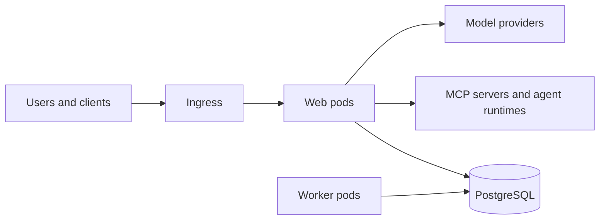

Install Archestra's web and worker pods, database, and workload permissions with the Helm chart. You need a Kubernetes cluster, Helm 3 or later, and `kubectl` access. Check [Production](/docs/admin/deployment/production) before exposing a shared instance.

Web pods serve the UI, API, LLM Proxy, and MCP Gateway. Workers process background jobs such as connector syncs and embeddings. Both use PostgreSQL; self-hosted MCP servers and agent runtimes run in separate pods.



## Install

Keep deployment-specific settings in `values.yaml` so upgrades use the same configuration.

1. Choose an exact version from [GitHub Releases](https://github.com/archestra-ai/archestra/releases) and download its chart defaults. Tags ending in `-rc.N` are release candidates:

   ```bash
   export ARCHESTRA_VERSION="1.5.0-rc.18" # x-release-please-version
   helm show values \
     oci://europe-west1-docker.pkg.dev/friendly-path-465518-r6/archestra-public/helm-charts/archestra-platform \
     --version "$ARCHESTRA_VERSION" > values.yaml
   ```

2. Edit `values.yaml` for your [PostgreSQL database](/docs/admin/deployment/database), [public URLs and ingress](/docs/admin/deployment/networking), and [secret storage](/docs/admin/deployment/secret-storage). Use `archestra.env` for non-secret values and `archestra.envWithValueFrom` or `archestra.envFromSecrets` for Secret references.
3. Install the selected version:

   ```bash
   helm upgrade archestra-platform \
     oci://europe-west1-docker.pkg.dev/friendly-path-465518-r6/archestra-public/helm-charts/archestra-platform \
     --version "$ARCHESTRA_VERSION" \
     --install --namespace archestra --create-namespace \
     --values values.yaml --wait
   ```

The chart generates and preserves authentication and credential-encryption keys. Back them up with your database. To supply existing keys, set `archestra.authSecret.existingSecretName`; the default key names are `auth-secret`, `session-secret`, `secrets-encryption-secret`, and `offer-signing-secret`.

To use different key names, configure them explicitly. Environment-variable-safe names also let you load the same Secret through `archestra.envFrom` on clusters that reject hyphens in environment variable names:

```yaml
archestra:
  authSecret:
    existingSecretName: archestra-auth
    existingSecretKey: ARCHESTRA_AUTH_SECRET
    existingSessionSecretKey: ARCHESTRA_AUTH_SESSION_SECRET
    existingSecretsEncryptionSecretKey: ARCHESTRA_SECRETS_ENCRYPTION_SECRET
    existingOfferSigningSecretKey: ARCHESTRA_OPENAPPA_OFFER_SIGNING_SECRET
```

### DNS Discovery

In-cluster installations can discover the DNS resolver from the platform pod's DNS configuration without creating resources in `kube-system`. Environment egress policies use that resolver to allow DNS lookups for MCP servers, agents, and sandboxes.

If workloads use a different resolver or discovery fails, configure verified addresses:

```yaml
archestra:
  orchestrator:
    kubernetes:
      clusterDnsIps:
        - 172.20.0.10 # Replace with your cluster's resolver IP.
```

Alternatively, set `archestra.orchestrator.kubernetes.rbac.kubeDnsServiceRead: true` to grant the platform service account `get` on the `kube-system/kube-dns` Service. This creates a Role and RoleBinding in `kube-system`; the installer and any GitOps project must permit managing both resources there. Creating the platform service account alone does not grant the installer this access.

Disabling an existing DNS reader grant does not guarantee Helm removes its Role and RoleBinding when the installer lacks access to `kube-system`. Have an operator with access to that namespace remove the release's DNS reader objects.

On EKS Auto Mode, check that workload DNS lookups succeed after deployment. If no resolver can be determined, [egress policies](/docs/admin/deployment/networking#enforce-workload-egress) omit the DNS bootstrap exception rather than allowing port 53 to arbitrary destinations.

### Verify the Installation

Confirm the rollout completes, then forward the service ports for a local check before configuring ingress:

```bash
kubectl --namespace archestra rollout status deployment/archestra-platform
kubectl --namespace archestra port-forward svc/archestra-platform 9000:9000 3000:3000
```

Open <http://localhost:3000> and [connect a client](/docs/get-started/connect). Send a model request and find it in **Logs → LLM Proxy**. The backend readiness endpoint, <http://localhost:9000/ready>, returns HTTP 503 until the API is ready.

## Scale Web and Worker Pods

Enable the chart's HorizontalPodAutoscaler (HPA) when web traffic varies with load. Your cluster needs the [resource metrics API](https://kubernetes.io/docs/concepts/workloads/autoscaling/horizontal-pod-autoscale/#support-for-metrics-apis), usually provided by Metrics Server:

```yaml
archestra:
  horizontalPodAutoscaler:
    enabled: true
    minReplicas: 2
    maxReplicas: 5
```

The HPA scales web pods only. Without it, set `archestra.replicaCount`; set `archestra.worker.replicaCount` for workers. [Size database connection capacity](/docs/admin/deployment/database#connection-capacity) for the HPA's maximum replicas and rollout overlap.

Start with the [production sizing example](/docs/admin/deployment/production#cluster-capacity), then adjust `archestra.resources` and `archestra.worker.resources` for pod sizing. To spread each workload across zones:

```yaml
archestra:
  topologySpreadConstraints:
    - maxSkew: 1
      topologyKey: topology.kubernetes.io/zone
      whenUnsatisfiable: DoNotSchedule
```

Agent Runtime pods scale separately from web and worker pods. See [production runtime capacity](/docs/admin/deployment/production#agent-runtime) for node autoscaling and [Runtime Setup](/docs/agents/runtime/setup) for cluster prerequisites.

## Upgrade

<!-- Describe the current chart behavior and supported upgrade procedure here. Do not add version-specific migration histories or before/after release narratives; those belong in release notes. -->

Use the installation command with the selected version and your current values after completing the [production release checks](/docs/admin/deployment/production#releases-and-backups).

Update `archestra.imageTag` in your values file too: an old values file or `--reuse-values` can keep the old image. Confirm the migration Job succeeds, the rollout completes, and a model request appears in the logs. Keep `archestra.migrationJob.enabled` enabled unless your pipeline applies migrations separately.

### Let Active Requests Finish

Set `archestra.shutdown.requestDrainSeconds` above the longest request you want to preserve after shutdown starts. For example, `200` gives a request with 180 seconds remaining room to finish. Keep `archestra.terminationGracePeriodSeconds: null` to derive matching web and worker pod limits. See [shutdown settings](/docs/admin/deployment/configuration#shutdown) for cleanup budgets and environment overrides.

During shutdown, readiness returns 503 and new work is rejected. Admitted LLM and MCP calls can finish within the drain budget, including their persistence work; MCP replies and cancellations for active calls remain available. Notification streams close after active calls settle. At the deadline, remaining HTTP connections close and unfinished work may be interrupted.

Reconnect notification streams to a live replica. An interrupted tool call can already have performed its side effect: retry only when the tool supports idempotency or after reconciling its result. The drain setting does not extend provider, MCP upstream or client timeouts; raise those separately when needed.

For Docker, set the same [shutdown environment variables](/docs/admin/deployment/configuration#shutdown) and allow at least `max(drain, worker timeout) + cleanup + 40` seconds in `docker stop --time` or Compose's `stop_grace_period`.

New companion and agent runtime images are published at `ghcr.io/archestra-ai`. The main platform image remains at `archestra/platform` on Docker Hub. If you mirror images internally, import the release’s companion images from GHCR and preserve your Helm registry overrides. Existing releases remain at their original addresses.
