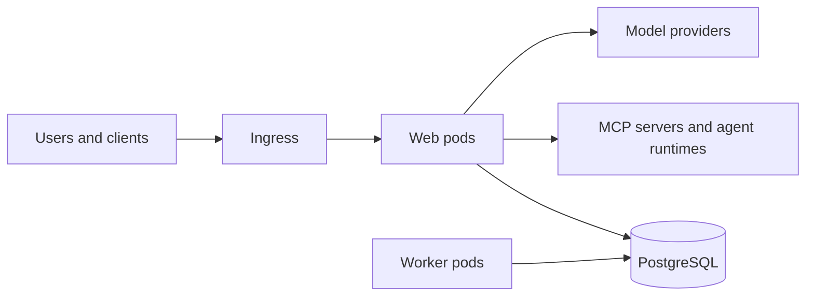

Install Archestra's web and worker pods, database, and workload permissions with the Helm chart. You need a Kubernetes cluster, Helm 3 or later, and `kubectl` access. Check [Production](/docs/admin/deployment/production) before exposing a shared instance.

Web pods serve the UI, API, LLM Proxy, and MCP Gateway. Workers process background jobs such as connector syncs and embeddings. Both use PostgreSQL; self-hosted MCP servers and agent runtimes run in separate pods.



## Install

Keep deployment-specific settings in `values.yaml` so upgrades use the same configuration.

1. Choose an exact version from [GitHub Releases](https://github.com/archestra-ai/archestra/releases) and download its chart defaults. Tags ending in `-rc.N` are release candidates:

   ```bash
   export ARCHESTRA_VERSION="1.5.0-rc.11" # x-release-please-version
   helm show values \
     oci://europe-west1-docker.pkg.dev/friendly-path-465518-r6/archestra-public/helm-charts/archestra-platform \
     --version "$ARCHESTRA_VERSION" > values.yaml
   ```

2. Edit `values.yaml` for your [PostgreSQL database](/docs/admin/deployment/database), [public URLs and ingress](/docs/admin/deployment/networking), and [secret storage](/docs/admin/deployment/secret-storage). Use `archestra.env` for non-secret values and `archestra.envWithValueFrom` or `archestra.envFromSecrets` for Secret references.
3. Install the selected version:

   ```bash
   helm upgrade archestra-platform \
     oci://europe-west1-docker.pkg.dev/friendly-path-465518-r6/archestra-public/helm-charts/archestra-platform \
     --version "$ARCHESTRA_VERSION" \
     --install --namespace archestra --create-namespace \
     --values values.yaml --wait
   ```

The chart generates and preserves authentication and credential-encryption keys. Back them up with your database. To supply existing keys, set `archestra.authSecret.existingSecretName` and `existingSecretKey`; the same Secret must contain `session-secret` and `secrets-encryption-secret`.

### Verify the Installation

Confirm the rollout completes, then forward the service ports for a local check before configuring ingress:

```bash
kubectl --namespace archestra rollout status deployment/archestra-platform
kubectl --namespace archestra port-forward svc/archestra-platform 9000:9000 3000:3000
```

Open <http://localhost:3000> and [connect a client](/docs/get-started/connect). Send a model request and find it in **Logs → LLM Proxy**. The backend readiness endpoint, <http://localhost:9000/ready>, returns HTTP 503 until the API is ready.

## Scale Web and Worker Pods

Set `archestra.replicaCount` for web pods and `archestra.worker.replicaCount` for workers. The web HPA, enabled with `archestra.horizontalPodAutoscaler.enabled`, overrides the web replica count; it does not autoscale workers. [Increase database connection capacity](/docs/admin/deployment/database#connection-capacity) alongside replicas.

Start with the [production sizing example](/docs/admin/deployment/production#cluster-capacity), then adjust `archestra.resources` and `archestra.worker.resources` for pod sizing. To spread each workload across zones:

```yaml
archestra:
  topologySpreadConstraints:
    - maxSkew: 1
      topologyKey: topology.kubernetes.io/zone
      whenUnsatisfiable: DoNotSchedule
```

## Upgrade

Use the installation command with the selected version and your current values after completing the [production release checks](/docs/admin/deployment/production#releases-and-backups).

Update `archestra.imageTag` in your values file too: an old values file or `--reuse-values` can keep the old image. Confirm the migration Job succeeds, the rollout completes, and a model request appears in the logs. Keep `archestra.migrationJob.enabled` enabled unless your pipeline applies migrations separately.

### Let Active Requests Finish

Keep `archestra.terminationGracePeriodSeconds` at least **120**. During shutdown, Archestra rejects new model requests and gives active requests up to 60 seconds to finish; longer requests can lose their connection.

For Docker, use `docker stop --time 120` or Compose's `stop_grace_period: 120s`.

New companion and agent runtime images are published at `ghcr.io/archestra-ai`. The main platform image remains at `archestra/platform` on Docker Hub. If you mirror images internally, import the release’s companion images from GHCR and preserve your Helm registry overrides. Existing releases remain at their original addresses.
