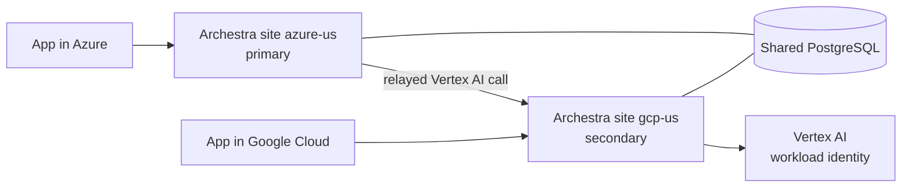

Some organizations run workloads in more than one cloud, for example Azure and Google Cloud, and want each cloud's apps to call models through an Archestra in the same cloud. Archestra supports this with **sites**: one install per cluster, all sharing one PostgreSQL database. Users, keys, model pools, limits, logs and spend live in that database, so every site shows and enforces the same configuration.

Each site calls the providers it can reach. A provider key that only works in one place, such as a keyless Vertex AI key that uses Google Cloud workload identity, names the site that serves it. When a request lands on another site, that site runs the whole proxy pipeline as usual (authentication, limits, guardrails, model pool selection, logging and spend) and relays only the provider call to the serving site. A request that lands on the serving site is answered there, without going through any other site.



## How It Works

- **One primary.** The primary site applies database migrations and owns the encryption key. Every other site is a **secondary**: it never migrates, only checks that its auth secret can read what the primary stored, and refuses to start on another version than the primary's.
- **Registration.** Each site writes its name, role, version, internal URL and the keyless providers its environment enables to the database on startup, and refreshes it every 15 seconds. A site silent for 45 seconds is treated as down.
- **Keys and sites.** A keyless provider key (Vertex AI, Azure OpenAI with Entra ID, keyless Anthropic, Bedrock with IAM) belongs to the site whose environment enables it, automatically. Each site creates, renames, syncs models for and deletes only its own keyless keys, so a site without Vertex AI settings never deletes the Vertex AI key another site serves. Keys with a stored secret can be used by any site.
- **Relayed calls.** A site sends a relayed call to the serving site's internal URL, signed with a key derived from the shared auth secret. The serving site makes the call with its own credentials and streams the answer back. The call is logged and charged once, on the site that received the request.
- **Model pools.** Within a priority, a pool tries members this site serves before members another site serves. A member whose site is down or draining is tried last.

## Set Up a Second Site

1. Upgrade the primary to the version you will run everywhere, and give it a site name. With the [Helm chart](/docs/admin/deployment/helm):

   ```yaml
   archestra:
     site:
       name: azure-us
       internalUrl: http://archestra.azure.internal:9000
   ```

2. Install the secondary in the other cluster with the **same version**, the **same database URL** and a **byte-for-byte copy of the primary's auth Secret** (`ARCHESTRA_AUTH_SECRET`, and the split secrets if you use them):

   ```yaml
   archestra:
     site:
       name: gcp-us
       role: secondary
       internalUrl: http://archestra.gcp.internal:9000
     orchestrator:
       enabled: false
     env:
       ARCHESTRA_GEMINI_VERTEX_AI_ENABLED: "true"
       ARCHESTRA_GEMINI_VERTEX_AI_PROJECT: my-project
       ARCHESTRA_GEMINI_VERTEX_AI_LOCATION: us-central1
   ```

   `role: secondary` skips the migration Job and startup migrations. Turn the [orchestrator](/docs/admin/deployment/configuration#ARCHESTRA_ORCHESTRATOR_ENABLED) off unless this site should run MCP servers.

3. Let each site reach the other's `internalUrl` on the backend port. Only the `/api/internal/sites/` paths are used, and every request carries a signed site token, so this can stay on your private network.

4. Point each cloud's apps at the site in that cloud. Virtual keys, model pools and limits work the same on every site.

To upgrade, upgrade the primary first, then each secondary to the same version. Until a secondary is upgraded it keeps running, but it refuses to restart on the old version. `ARCHESTRA_SITE_ALLOW_VERSION_SKEW=true` lets a secondary start anyway, for a deliberate mixed-version window.

## Limits

- Every site talks to the shared database directly, so a site far from it pays that round trip on every request.
- The database is shared: if it is down, every site is down.
- Every site holds the auth secret, so every site can read every stored secret.
- A relayed call is limited to the chat and messages endpoints that model pools support (OpenAI chat completions and responses, Anthropic messages, Gemini, Bedrock Converse). Embeddings, images and audio on a key another site serves answer with an error that names the site.
