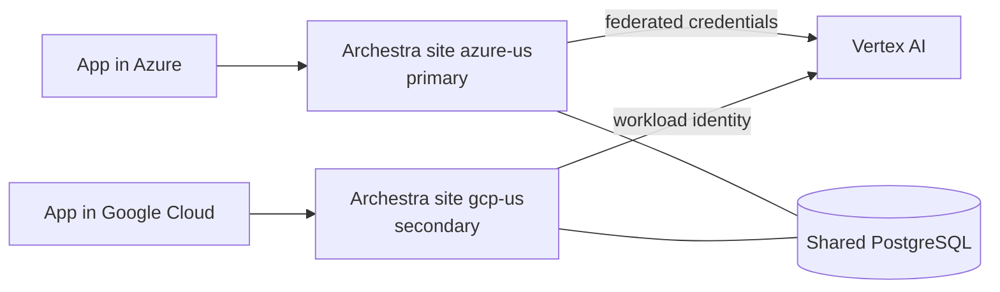

Some organizations run workloads in more than one cloud, for example Azure and Google Cloud, and want each cloud's apps to call models through an Archestra in the same cloud. Archestra supports this with **sites**: one install per cluster, all sharing one PostgreSQL database. Users, keys, model pools, limits, logs and spend live in that database, so every site shows and enforces the same configuration.

Every site calls providers directly, so each request is served where it lands, with no hop through another site. To reach a cloud-only provider such as Vertex AI from a site in another cloud, give that site [federated credentials](#call-a-cloud-provider-from-another-cloud) for it.



## How It Works

- **One primary.** The primary site applies database migrations and owns the encryption key. Every other site is a **secondary**: it never migrates, only checks that its auth secret can read what the primary stored, and refuses to start on another version than the primary's.
- **Registration.** Each site writes its name, role, version, internal URL and the keyless providers its environment enables to the database on startup, and refreshes it every 15 seconds.
- **Keyless keys.** A keyless provider key (Vertex AI, Azure OpenAI with Entra ID, keyless Anthropic, Bedrock with IAM) is shared by all sites. Only sites whose environment has credentials for that provider call it. A site without them skips it in model pools and auto routing, answers a request on that key alone with an error naming the site, and never deletes the key while another site still enables the provider. Keys with a stored secret work on every site.
- **Model pool health.** A timeout or an unreachable provider sets a member aside on the site that saw it, since it is about that site's network. Rate limits, authentication and quota errors set it aside on every site.

## Set Up a Second Site

1. Upgrade the primary to the version you will run everywhere, and give it a site name. With the [Helm chart](/docs/admin/deployment/helm):

   ```yaml
   archestra:
     site:
       name: azure-us
   ```

2. Install the secondary in the other cluster with the **same version**, the **same database URL** and a **byte-for-byte copy of the primary's auth Secret** ([`ARCHESTRA_AUTH_SECRET`](/docs/admin/deployment/configuration#ARCHESTRA_AUTH_SECRET), and the split secrets if you use them):

   ```yaml
   archestra:
     site:
       name: gcp-us
       role: secondary
     orchestrator:
       enabled: false
     env:
       ARCHESTRA_GEMINI_VERTEX_AI_ENABLED: "true"
       ARCHESTRA_GEMINI_VERTEX_AI_PROJECT: my-project
       ARCHESTRA_GEMINI_VERTEX_AI_LOCATION: us-central1
   ```

   `role: secondary` skips the migration Job and startup migrations. Turn the [orchestrator](/docs/admin/deployment/configuration#ARCHESTRA_ORCHESTRATOR_ENABLED) off unless this site should run MCP servers.

3. Point each cloud's apps at the site in that cloud. Virtual keys, model pools and limits work the same on every site.

To upgrade, upgrade the primary first, then each secondary to the same version. Until a secondary is upgraded it keeps running, but it refuses to restart on the old version. [`ARCHESTRA_SITE_ALLOW_VERSION_SKEW=true`](/docs/admin/deployment/configuration#ARCHESTRA_SITE_ALLOW_VERSION_SKEW) lets a secondary start anyway, for a deliberate mixed-version window.

## Run a Site Far from the Database

A site in another cloud or region than the database pays a round trip for each database statement, and an LLM proxy request makes about twenty. Set [`ARCHESTRA_SITE_REMOTE_DATABASE=true`](/docs/admin/deployment/configuration#ARCHESTRA_SITE_REMOTE_DATABASE) on that site (in Helm, `archestra.site.remoteDatabase: true`) so a warm request makes none:

- **Configuration reads come from a cache in each pod.** Keys, users, permissions, models, pools, limits and pricing are read once and kept for up to 5 seconds. Most changes drop the cache at once through database notifications; the rest, such as budget usage, show up within those 5 seconds.
- **Logs and spend are written after the response.** A failed write is retried for 2 minutes, then dropped and logged. When 1,000 writes are waiting in a pod, new requests write before they respond, so an unreachable database slows requests down instead of losing records.

What this changes on that site:

- A limit is enforced up to a few seconds late, so a burst can overshoot it a little.
- A log appears shortly after the response.
- A revoked key or token keeps working for up to 5 seconds.
- The first request after a configuration change still reads from the database.

## Call a Cloud Provider from Another Cloud

Keyless providers read their cloud credentials the standard way, so a site in another cloud can use federated credentials instead of a stored key. Mount a projected Kubernetes service account token with `archestra.extraVolumes` and `archestra.extraVolumeMounts`, and trust that cluster's OIDC issuer in the provider's cloud:

| Provider | In the provider's cloud | On the site |
| --- | --- | --- |
| Vertex AI (Gemini, Anthropic) | A Workload Identity Federation pool with an OIDC provider for the cluster's issuer, and `roles/aiplatform.user` for the site's service account | A credential configuration file (`gcloud iam workload-identity-pools create-cred-config`) in [`ARCHESTRA_GEMINI_VERTEX_AI_CREDENTIALS_FILE`](/docs/admin/deployment/configuration#ARCHESTRA_GEMINI_VERTEX_AI_CREDENTIALS_FILE) or [`ARCHESTRA_ANTHROPIC_VERTEX_AI_CREDENTIALS_FILE`](/docs/admin/deployment/configuration#ARCHESTRA_ANTHROPIC_VERTEX_AI_CREDENTIALS_FILE) |
| Bedrock (IAM) | An IAM OIDC identity provider for the cluster's issuer, and a role it may assume | `AWS_ROLE_ARN` and `AWS_WEB_IDENTITY_TOKEN_FILE` |
| Azure OpenAI (Entra ID) | A federated credential on an Entra app registration or user-assigned identity, for the cluster's issuer and service account | `AZURE_CLIENT_ID`, `AZURE_TENANT_ID` and `AZURE_FEDERATED_TOKEN_FILE` |

Then enable the provider on that site as usual (for example [`ARCHESTRA_GEMINI_VERTEX_AI_ENABLED`](/docs/admin/deployment/configuration#ARCHESTRA_GEMINI_VERTEX_AI_ENABLED)).

## Limits

- Every site talks to the shared database directly. A site far from it pays the round trip on every proxy request, or, in [remote database mode](#run-a-site-far-from-the-database), only on admin pages and on requests that miss its cache.
- The database is shared: if it is down, every site is down.
- Every site holds the auth secret, so every site can read every stored secret.
