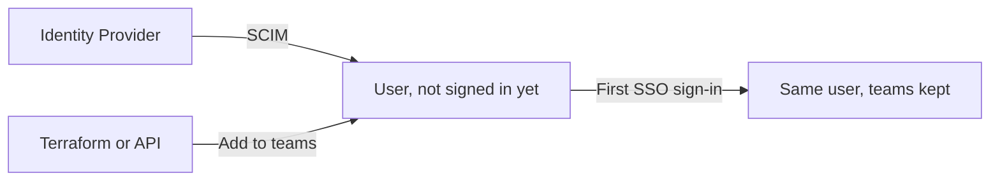

<!-- Renaming/deleting this file? Add a redirect in docs/redirects.json. -->

Put people in teams before they ever sign in. Add someone to the Archestra group in Microsoft Entra ID, and they appear in Archestra within minutes, ready for your Terraform or scripts to add to teams. Remove them from the group, and they lose all access while their chats, agents, and teams stay. Archestra speaks [SCIM 2.0](https://www.rfc-editor.org/rfc/rfc7644), the standard identity providers use to push users to apps. This is an [Enterprise feature](/docs/get-started/pricing-model).

## How It Works

Your identity provider creates, deactivates, and restores Archestra users. Sign-in stays with [Single Sign-On](/docs/admin/identity/sso).

- **Pushed:** the person becomes a user with the organization's **Default Roles for New Users** from **Settings → Auth**, and no team. They show in **Settings → Users**.
- **First sign-in:** their SSO sign-in opens that same user, so the teams you added are already there. From then on, the provider's [Role Mapping](/docs/admin/identity/sso#role-mapping) applies as for every SSO sign-in.
- **Deactivated or deleted** in the identity provider: the user can no longer sign in, and their API keys, gateway tokens, and chat integrations stop working. Their data and teams stay, and **Settings → Users** marks them **Deactivated**. Adding them back to the group restores them.

Archestra never deletes a user through SCIM. To remove someone for good, use **Remove user** in **Settings → Users**.

## Before You Start

- Single Sign-On with the same identity provider works, and its **Allowed Email Domains** lists every domain your users sign in with. Without that, the first sign-in of a pushed user can fail with **Account Not Linked**.
- Your identity provider can reach Archestra over HTTPS.

## Set Up Microsoft Entra ID

1. In Archestra, create a [service account](/docs/reference/api#service-accounts) with the **User Writer** role, which holds [`member:read`](/docs/reference/permissions#member:read), [`member:create`](/docs/reference/permissions#member:create), [`member:update`](/docs/reference/permissions#member:update), and [`member:delete`](/docs/reference/permissions#member:delete). Create a key for it and copy it.
2. In the Microsoft Entra admin center, go to **Enterprise applications**, open the app you use for Archestra sign-in, and open **Provisioning**. Set **Provisioning Mode** to **Automatic**.
3. Under **Admin Credentials**, set **Tenant URL** to your Archestra address followed by `/api/scim/v2`, for example `https://archestra.example.com/api/scim/v2`. Paste the key into **Secret Token**, then click **Test Connection**.
4. Under **Mappings**, turn off **Provision Microsoft Entra ID Groups**: Archestra takes users, and your teams come from Archestra.
5. In the user mapping, make sure `userName` gets the email people sign in with. Entra sends `userPrincipalName` by default. If it differs from their email, map `userName` from `mail`.
6. Under **Settings**, set **Scope** to **Sync only assigned users and groups**, and under **Users and groups**, assign the group.
7. Use **Provision on demand** for one person, check that they appear in **Settings → Users**, then set **Provisioning Status** to **On**.

Entra pushes everyone in the group on its first cycle, then sends changes on its own schedule. Any other identity provider with SCIM 2.0 user provisioning, such as Okta, uses the same address and key.

## Add Pushed Users to Teams

Pushed users are members you can add to teams right away, by email, before they sign in:

- **Terraform:** look the person up with the `archestra_user` data source and list them in the `members` of an `archestra_team`.
- **API:** look up the user ID with `GET /api/organization/members/{email}`, then call `POST /api/teams/{teamId}/members`.

Run either with a service account key whose role holds [`team:update`](/docs/reference/permissions#team:update), such as **Team Writer**.

## Troubleshooting

| What you see | Cause and fix |
| --- | --- |
| Someone signs in and has none of their teams | Their sign-in email differs from the `userName` Entra pushed, so Archestra created a second user. Map `userName` to the sign-in email, then remove the extra user in **Settings → Users**. |
| **Account Not Linked** at first sign-in | Add their email domain to the provider's **Allowed Email Domains**. |
| **Account Deactivated** at sign-in | They were removed from the group or the app in Entra. Assign them again. |
| **Test Connection** fails | Check the tenant URL ends in `/api/scim/v2`, the key is active, and its role holds the `member` permissions. |
