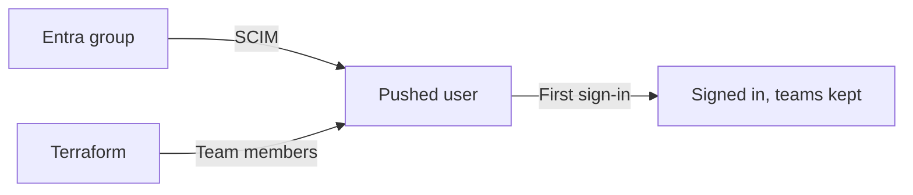

<!-- Renaming/deleting this file? Add a redirect in docs/redirects.json. -->

Archestra supports user provisioning from Microsoft Entra ID over [SCIM 2.0](https://www.rfc-editor.org/rfc/rfc7644). Entra creates a user in Archestra when you assign them to the Archestra app, and deactivates the user when you unassign them. Without provisioning, a user exists only after their first Single Sign-On sign-in. This is an [Enterprise feature](/docs/get-started/pricing-model).

## User Lifecycle

How Archestra handles each change from Entra:

- **Assigned in Entra:** Archestra creates the user with the status **Pending (auto-provisioned)** and the **Default Roles for New Users** from **Settings → Auth**.
- **First sign-in:** Single Sign-On signs the person in as the provisioned user, with any roles and teams assigned to it.
- **Unassigned in Entra:** Archestra deactivates the user, and **Settings → Users** shows them as **Deactivated**. They can't sign in, and their API keys, gateway tokens, and chat integrations stop working. Their chats, agents, and team memberships are kept. Assigning them in Entra again reactivates the user.

What to know:

- Archestra never deletes a user through SCIM. To delete a user, use **Remove user** in **Settings → Users**.
- Deactivated users don't count toward the 30-user free tier.

## Set Up Microsoft Entra ID

You turn on provisioning in the Entra app your people already use to sign in to Archestra. Before you start:

- [Single Sign-On](/docs/admin/identity/sso) with Entra works.
- In **Settings → Identity Providers**, the Entra provider's **Allowed Email Domains** lists your email domains. Otherwise, a pushed user's first sign-in fails with **Account Not Linked**.
- Entra can reach your Archestra address over HTTPS.

Then:

1. In Archestra, go to **Settings → Service Accounts** and create a service account. Give it a role that holds [`member:read`](/docs/reference/permissions#member:read), [`member:create`](/docs/reference/permissions#member:create), [`member:update`](/docs/reference/permissions#member:update), and [`member:delete`](/docs/reference/permissions#member:delete), such as the predefined **User Writer**. Create a key for it and copy it.
2. In the Microsoft Entra admin center, go to **Enterprise applications** and open your Archestra sign-in app. Open **Provisioning** and set **Provisioning Mode** to **Automatic**.
3. Under **Admin Credentials**, set **Tenant URL** to your Archestra address plus `/api/scim/v2`, for example `https://archestra.example.com/api/scim/v2`. Paste the service account key into **Secret Token** and click **Test Connection**.
4. Under **Mappings**, turn off **Provision Microsoft Entra ID Groups**. Archestra takes only users over SCIM. This turns off groups for SCIM only: the groups in the sign-in token stay, so [Team Sync](/docs/admin/identity/sso#team-sync) keeps working.
5. In the user mapping, check that `userName` gets the email people sign in with. Entra sends `userPrincipalName` by default. If that is not their email, map `userName` from `mail`.
6. Under **Settings**, set **Scope** to **Sync only assigned users and groups**.
7. Under **Users and groups**, assign the people or groups who should get Archestra.
8. Click **Provision on demand**, pick one person, and check that they appear in **Settings → Users**. Then set **Provisioning Status** to **On**.

Entra then pushes everyone assigned and keeps Archestra up to date on its own schedule.

What to know:

- Assigning a group needs an Entra ID P1 or P2 license. Microsoft 365 E3 and E5 include it. Without one, assign people one by one.
- The pushed email must match the sign-in email. If it doesn't, the first sign-in creates a second, empty user.

## Example: One Entra Group, Teams in Terraform

Give everyone access through one Entra group, and keep team membership in Terraform. You don't need an Entra group per team.



1. In Entra, assign one group, for example **Archestra Users**, to the Archestra app.
2. Give the same service account a role that holds [`team:update`](/docs/reference/permissions#team:update), such as the predefined **Team Writer**. Use its key in Terraform.
3. Look up each person by email with the `archestra_user` data source, and list them in the team's `members`:

   ```hcl
   locals {
     payments = ["alice@example.com", "bob@example.com"]
   }

   data "archestra_user" "payments" {
     for_each = toset(local.payments)
     email    = each.value
   }

   resource "archestra_team" "payments" {
     name    = "Payments"
     members = [for user in data.archestra_user.payments : { user_id = user.id }]
   }
   ```

4. Run `terraform apply`. Alice and Bob are in **Payments** before their first sign-in.

What to know:

- Apply after Entra has pushed the person. Until then, the plan fails with **User Not Found**.
- Don't set `external_group_ids` on teams that Terraform manages. Each apply removes the people Team Sync added, their next sign-in adds them back, and every plan shows changes.
- A sign-in never removes people Terraform added.

## Troubleshooting

| What you see | Fix |
| --- | --- |
| Someone signs in and has none of the roles or teams you gave them | Entra pushed a different email than the one they sign in with, so Archestra created a second user. Fix the `userName` mapping and remove the extra user in **Settings → Users**. Then use **Provision on demand** for them. |
| **Account Not Linked** at first sign-in | Add their email domain to the Entra provider's **Allowed Email Domains**. |
| **Account Deactivated** at sign-in | They were unassigned in Entra. Assign them again. |
| **Test Connection** fails | Check that **Tenant URL** ends in `/api/scim/v2`, the key is active, and the service account holds the `member` permissions. |
