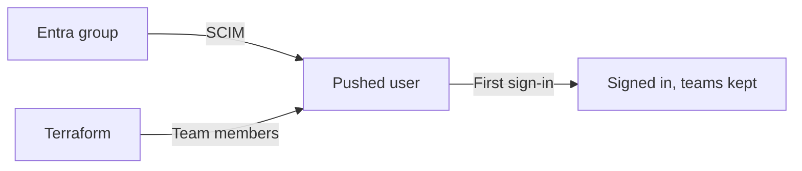

<!-- Renaming/deleting this file? Add a redirect in docs/redirects.json. -->

Add people to teams before their first sign-in. Normally a person exists in Archestra only after they sign in once, so nobody can add them to a team ahead of time. With provisioning, Microsoft Entra ID creates them in Archestra as soon as they are assigned to the Archestra app. Archestra uses [SCIM 2.0](https://www.rfc-editor.org/rfc/rfc7644), the standard Entra uses to push users to apps. This is an [Enterprise feature](/docs/get-started/pricing-model).

What happens to a person Entra pushes:

- **Created:** they appear in **Settings → Users** as **Pending (auto-provisioned)**, with the **Default Roles for New Users** from **Settings → Auth** and no team. You can add them to teams right away.
- **First sign-in:** their Single Sign-On sign-in opens that same user, so the teams you added are already there.
- **Removed in Entra:** they can no longer sign in, and their API keys, gateway tokens, and chat integrations stop working. Their chats, agents, and teams stay, and **Settings → Users** marks them **Deactivated**. Assigning them again restores them.

Archestra never deletes a user through SCIM. To remove someone for good, use **Remove user** in **Settings → Users**. Deactivated users don't count toward the 30-user free tier.

## Set Up Microsoft Entra ID

You turn on provisioning in the same Entra app your people already use to sign in to Archestra. Before you start:

- [Single Sign-On](/docs/admin/identity/sso) with Entra works, and the provider's **Allowed Email Domains** lists every domain your people sign in with. Without that, a pushed user's first sign-in fails with **Account Not Linked**.
- Entra can reach your Archestra address over HTTPS.

Then:

1. In Archestra, go to **Settings → Service Accounts** and create a service account with a role that holds [`member:read`](/docs/reference/permissions#member:read), [`member:create`](/docs/reference/permissions#member:create), [`member:update`](/docs/reference/permissions#member:update), and [`member:delete`](/docs/reference/permissions#member:delete), such as the predefined **User Writer**. Create a key for it and copy it.
2. In the Microsoft Entra admin center, go to **Enterprise applications**, open the app you use for Archestra sign-in, and open **Provisioning**. Set **Provisioning Mode** to **Automatic**.
3. Under **Admin Credentials**, set **Tenant URL** to your Archestra address followed by `/api/scim/v2`, for example `https://archestra.example.com/api/scim/v2`. Paste the service account key into **Secret Token**, then click **Test Connection**.
4. Under **Mappings**, turn off **Provision Microsoft Entra ID Groups**. Archestra takes only users over SCIM. This setting affects SCIM only, not Single Sign-On: the groups in the sign-in token, set under **Single sign-on → Attributes & Claims**, stay as they are, so [Team Sync](/docs/admin/identity/sso#team-sync) keeps working.
5. In the user mapping, make sure `userName` gets the email people sign in with. Entra sends `userPrincipalName` by default. If that differs from their email, map `userName` from `mail`.
6. Under **Settings**, set **Scope** to **Sync only assigned users and groups**.
7. Under **Users and groups**, assign the people or the group who should get Archestra.
8. Use **Provision on demand** for one person, and check that they appear in **Settings → Users**. Then set **Provisioning Status** to **On**.

Entra pushes everyone assigned on its first cycle, then sends changes on its own schedule.

What to know:

- Assigning a group to the app needs an Entra ID P1 or P2 license, which Microsoft 365 E3 and E5 include. Without it, assign people one by one.
- The email Entra pushes must be the email the person signs in with. If they differ, the first sign-in creates a second, empty user instead of opening the pushed one.

## Example: One Entra Group, Teams in Terraform

Give everyone access through one Entra group, and keep each team's members in Terraform. Nobody needs a separate Entra group per team.



1. In Entra, assign one group, for example **Archestra Users**, to the Archestra app. Everyone in it appears in **Settings → Users**.
2. Add a role that holds [`team:update`](/docs/reference/permissions#team:update) to the same service account, such as the predefined **Team Writer**, and use its key in Terraform. Looking people up by email uses [`member:read`](/docs/reference/permissions#member:read), which it already has.
3. Look each person up by email with the `archestra_user` data source, and list them in the team's `members`:

   ```hcl
   locals {
     payments = ["alice@example.com", "bob@example.com"]
   }

   data "archestra_user" "payments" {
     for_each = toset(local.payments)
     email    = each.value
   }

   resource "archestra_team" "payments" {
     name    = "Payments"
     members = [for user in data.archestra_user.payments : { user_id = user.id }]
   }
   ```

4. Run `terraform apply`. When Alice signs in for the first time, she is already in **Payments**.

What to know:

- Apply after Entra has pushed the person. Until then, `archestra_user` can't find their email and the plan fails.
- Keep `external_group_ids` off teams that Terraform fills. Each apply removes anyone not in `members`, including people Team Sync added, and their next sign-in adds them back, so every plan shows changes.
- A sign-in never removes people Terraform added to a team.

## Troubleshooting

| What you see | Cause and fix |
| --- | --- |
| Someone signs in and has none of their teams | Their sign-in email differs from the `userName` Entra pushed, so Archestra created a second user. Map `userName` to the sign-in email, remove the extra user in **Settings → Users**, then use **Provision on demand** for that person. Their next sign-in opens the pushed user, with their teams. |
| **Account Not Linked** at first sign-in | Add their email domain to the provider's **Allowed Email Domains**. |
| **Account Deactivated** at sign-in | They were removed from the group or the app in Entra. Assign them again. |
| **Test Connection** fails | Check that the tenant URL ends in `/api/scim/v2`, the key is active, and the service account holds the `member` permissions. |
