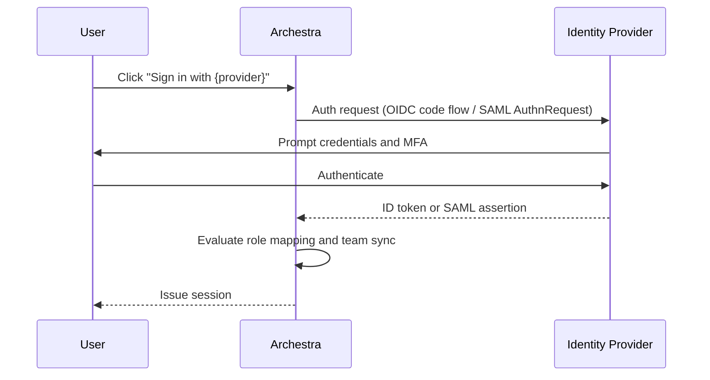

<!-- Renaming/deleting this file? Add a redirect in docs/redirects.json. -->

Sign people in with their workplace identity and assign their Archestra roles and teams from directory claims. Start with [Adding a Provider](/docs/admin/identity#adding-a-provider), then configure the mappings below.

Identity providers are an enterprise feature. See [Pricing Model](/docs/get-started/pricing-model).

## Supported Protocols

Use the protocol your identity provider supports:

- **OIDC (OpenID Connect):** Modern OAuth 2.0 + OIDC for Microsoft Entra ID, Okta, Google, GitHub, GitLab, Auth0, and Keycloak.
- **SAML 2.0:** Providers configured to send SAML assertions.

## Callback URLs

Configure the callback URL in your identity provider before enabling SSO in Archestra. The `{ProviderId}` path segment is case-sensitive and must match the Archestra provider ID (`Okta`, `EntraID`, `Google`, `GitHub`, `GitLab`, or your custom ID).

| Protocol | Production Callback URL | Local Development URL |
| --- | --- | --- |
| **OIDC** | `https://<domain>/api/auth/sso/callback/{ProviderId}` | `http://localhost:3000/api/auth/sso/callback/{ProviderId}` |
| **SAML (ACS URL)** | `https://<domain>/api/auth/sso/saml2/sp/acs/{ProviderId}` | `http://localhost:3000/api/auth/sso/saml2/sp/acs/{ProviderId}` |

## Sign-In Boundaries

Limit which accounts can sign in through an identity provider:

- **Allowed Email Domains:** Enter comma-separated domains (such as `company.com, subsidiary.com`). Subdomains match automatically (`eng.company.com` matches `company.com`).
- **Downstream-only providers:** Uncheck **Use for Single Sign-On** to use a provider solely for MCP tool token exchange. The provider remains hidden from the sign-in screen, and its role mapping rules never apply.

## Change an Email Claim

For OIDC providers, keep **User ID Claim** unchanged when changing **Email Claim**. Archestra uses the provider and user ID to recognize an existing SSO user.

With OIDC profile updates enabled, the user's next successful sign-in updates their email on the same account. Saving the mapping leaves their email and active sessions unchanged. If that account also has a password, use the updated email with the existing password afterward.

An email already used by another signed-in account causes a conflict. Resolve the duplicate account before retrying; changing the claim does not merge established accounts.

## Role Mapping

Use [Handlebars](https://handlebarsjs.com/) templates to map directory claims to Archestra roles. Editing a provider requires [`identityProvider:update`](/docs/reference/permissions#identityProvider:update).

When a user signs in, Archestra tests the token claims against your mapping rules in order. The first rule whose template returns a non-empty string assigns its roles.

1. In **Settings → Identity Providers**, edit your provider and select **Role Mapping**.
2. Add one or more **Mapping Rules** with a template and target roles.
3. Set **Default Roles** for new users who match no rule.
4. Optional: Turn on **Strict Mode** to block sign-in for users who match no rule.
5. Optional: Turn on **Skip Role Sync** to evaluate roles only on first sign-in, leaving subsequent role changes to manual administration.

Sign in with a test user in each mapped group and check their assigned roles in **Settings → Users**.

### Template Helpers

Return a non-empty string only when the rule should match.

| Helper | Purpose | Example |
| --- | --- | --- |
| `includes` | Check if an array contains a value (case-insensitive) | `{{#includes groups "admins"}}true{{/includes}}` |
| `equals` | String equality check | `{{#equals role "admin"}}true{{/equals}}` |
| `and` / `or` | Boolean logic | `{{#and dept title}}{{#equals dept "IT"}}true{{/equals}}{{/and}}` |
| `json` | Parse JSON string or serialize value | `{{#with (json roles)}}{{#each this}}{{#equals this.name "admin"}}true{{/equals}}{{/each}}{{/with}}` |

For OIDC providers, ensure the ID token includes the groups claim. Many providers omit groups unless the `groups` scope is requested during authorization.

## Team Sync

Automatically add and remove users from Archestra teams based on directory group memberships.

Sync creates direct membership in the mapped team, while preserving members added manually in Archestra.

1. In the provider's **Team Sync** tab, verify **Enable Team Sync** is on.
2. If your IdP uses custom group claim paths, set **Groups Handlebars Template** (e.g. `{{#each groups}}{{this}},{{/each}}`). Otherwise, Archestra checks `groups`, `group`, `memberOf`, `roles`, and `teams` in order.
3. Go to **Settings → Teams**, click **Edit** on target team, and open **External Group Sync**.
4. Enter the external group identifier (such as an Entra group object ID or Okta group name) and click **Add**.

Sign in with a test user and check membership in the mapped team. Then remove the source group membership and sign in again to verify removal. Manually added memberships remain.

## Enforcing SSO

Test SSO in a separate browser session before disabling password sign-in. Keep a working session open while checking the change:

1. **Disable password sign-in:** Set [`ARCHESTRA_AUTH_DISABLE_BASIC_AUTH=true`](/docs/reference/configuration#ARCHESTRA_AUTH_DISABLE_BASIC_AUTH) in the backend environment and restart. This hides the email/password form and requires SSO.
2. **Disable invitations:** Set [`ARCHESTRA_AUTH_DISABLE_INVITATIONS=true`](/docs/reference/configuration#ARCHESTRA_AUTH_DISABLE_INVITATIONS) to disable manual user invite workflows.
3. Open a fresh private browser window. Confirm the password form is absent and an SSO sign-in completes.

If SSO fails while password authentication is disabled, recover via the command line with [Account Security](/docs/admin/identity/account-security#reset-a-password-from-the-cli).

## Troubleshooting

Start with the callback and claims sent by your IdP.

| Symptom | Cause | Fix |
| --- | --- | --- |
| `state_mismatch` | Cookies blocked or mismatched callback URL | Retry the flow in one browser session and verify its cookies are accepted. Check the redirect URI and case-sensitive `{ProviderId}`. |
| `account not linked` | Mismatched or unverified email | Confirm the user signs in with the email address registered on Archestra, and verify the email in the IdP. |
| `account_not_found` (SAML) | Missing user attributes | Configure your SAML IdP to include `NameID` in `emailAddress` format, plus `email`, `firstName`, and `lastName`. |
| `signature_validation_failed` | Expired or rotated SAML certificate | Re-download your IdP SAML metadata and update the certificate in Archestra. |
| User missing team membership | Group claim omitted or identifier typo | Confirm the IdP sends the group claim in the ID token and that the group name in **Settings → Teams** matches verbatim. |
