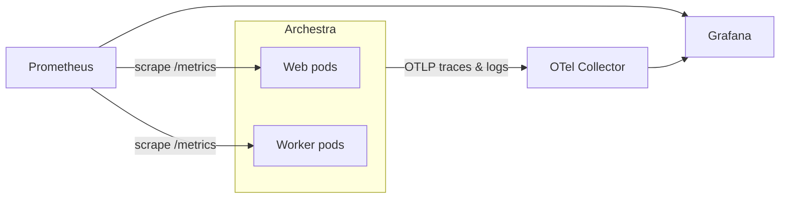

<!-- Renaming/deleting this file? Add a redirect in docs/redirects.json. -->

Export production telemetry to your existing monitoring stack: Prometheus metrics, OpenTelemetry distributed traces and logs, and web UI user sessions.

Archestra tracks model token usage, latency, execution costs, tool call failures, and background worker queues across every agent run.

| Signal | Protocol | Destination | Configuration |
| --- | --- | --- | --- |
| [Metrics](/docs/admin/observability/metrics) | Prometheus | Scraped from `/metrics` | Enabled by default |
| [Traces and Logs](/docs/admin/observability/tracing) | OTLP HTTP | Pushed to OpenTelemetry collector | [`ARCHESTRA_OTEL_EXPORTER_OTLP_ENDPOINT`](/docs/reference/configuration#ARCHESTRA_OTEL_EXPORTER_OTLP_ENDPOINT) |
| Real User Monitoring | OTLP HTTP | Browser events forwarded to collector | [`ARCHESTRA_RUM_EXPORTER_OTLP_ENDPOINT`](/docs/reference/configuration#ARCHESTRA_RUM_EXPORTER_OTLP_ENDPOINT) (Enterprise) |



## Scraping Prometheus Metrics

Each Archestra process serves Prometheus metrics on a dedicated port:

- **Web pods:** `http://<pod>:9050/metrics`. Port configurable with [`ARCHESTRA_METRICS_PORT`](/docs/reference/configuration#ARCHESTRA_METRICS_PORT).
- **Worker pods:** `http://<pod>:9000/metrics`. Knowledge sync and background queue metrics emit from worker pods. Both endpoints include embedded Guardrails hook and engine metrics.

To require authentication on metric scrapes, set [`ARCHESTRA_METRICS_SECRET`](/docs/reference/configuration#ARCHESTRA_METRICS_SECRET) to require an `Authorization: Bearer <secret>` header. See the full list in the [Metrics Reference](/docs/admin/observability/metrics).

## Distributed Tracing and Logs

Export distributed spans and structured logs to any OpenTelemetry collector:

```bash
ARCHESTRA_OTEL_EXPORTER_OTLP_ENDPOINT=http://otel-collector:4318
```

Archestra pushes traces to `/v1/traces` and backend logs to `/v1/logs` under service name `Archestra`. Every LLM generation and tool call forms a span containing model names, token counts, costs, and caller identity. See [Tracing](/docs/admin/observability/tracing).

## Grafana Dashboards

<span id="grafana-dashboards"></span>

Archestra publishes eight prebuilt Grafana dashboards. Core operational dashboards require Prometheus only.

| Dashboard | Key Visualizations | Data Sources |
| --- | --- | --- |
| LLM Proxy (`archestra-genai-observability`) | Proxy and model router outcomes, upstream and streaming latency, token rates, and prompt-cache usage | Prometheus (optional Tempo for exemplars) |
| Costs & Limits | Metered and subscription spend, prompt-cache savings, limit rule evaluations, storage errors, and recent exhausted allowances | Prometheus |
| Agent Runtime | Fleet-wide run lifecycle, provisioning latency, steering, completion delivery, boundary refusals, task health, and optional Kubernetes pod resources | Prometheus (optional Kubernetes Prometheus with cAdvisor and `kube-state-metrics`) |
| Guardrails / OpenAPPA | Embedded OpenAPPA hook dispatches and latency by hook and decision, runtime boundary refusals and engine operations | Prometheus |
| MCP Monitoring (`archestra-mcp-monitoring`) | MCP Gateway tool call rates, error counts, execution duration, payload sizes, and self-hosted server deployment status | Prometheus (optional Tempo for exemplars) |
| Knowledge Base Operations (`archestra-rag-knowledge-base`) | Connector syncs, document ingestion, OCR, embedding batches, search latency, quote verification, and permission sync gaps | Prometheus |
| Platform Health (`archestra-application-metrics`) | HTTP throughput, Node.js memory and event loop lag, database connection pool, background task queue, and PostgreSQL health | Prometheus |
| Session Investigation (`archestra-agent-sessions`) | Per-session timeline, LLM calls, MCP tool invocations, trace waterfalls, and correlated logs across [Agent Runtime](/docs/agents/runtime) and external client sessions | Tempo; optional Loki |

Import or update the dashboards with a Grafana service account that can write dashboards and folders and read/query the selected data sources. Basic authentication also works with `GRAFANA_USER` and `GRAFANA_PASS`:

```bash
GRAFANA_URL=https://grafana.example.com GRAFANA_TOKEN=glsa_xxx \
  bash <(curl -sL https://raw.githubusercontent.com/archestra-ai/archestra/release/1.4/platform/dev/grafana/install-dashboards.sh)
```

<span id="exemplars"></span>

The installer is idempotent and upserts every dashboard into the `Archestra` folder (`archestra-dashboards`) using stable UIDs—including `archestra-genai-observability` for **LLM Proxy**, `archestra-application-metrics` for **Platform Health**, and `archestra-agent-sessions` for **Session Investigation**—so existing dashboard links stay intact. For external databases on **Platform Health**, pass `--postgres-provider otel` (or `cloudsql`, `azure`; defaults to `helm` for the Bitnami `postgres_exporter` sidecar). To link upstream latency spikes on **LLM Proxy** and **MCP Monitoring** to Tempo traces, enable Prometheus exemplars with `--enable-feature=exemplar-storage`.

To preselect data sources during import, pass their Grafana UIDs:

```bash
GRAFANA_URL=https://grafana.example.com GRAFANA_TOKEN=glsa_xxx \
  ./install-dashboards.sh --metrics-datasource prometheus \
  --traces-datasource tempo --logs-datasource loki
```

`--kubernetes-datasource` selects a separate Prometheus source for optional Kubernetes rows and defaults to the metrics UID.

### Data Sources and Metric Semantics

Model and agent filters on **LLM Proxy** affect upstream usage; logical request outcomes have their own filters. **Costs & Limits** has separate cost and limit filters, with **Cost breakdown** selecting the grouping dimension. **Scrape job** selects a Prometheus target group; leave **All** selected unless you need one group of processes.

Each dashboard scopes its optional data sources and aggregates multi-replica metrics according to how Archestra exports them:

- **Session timelines vs. runtime fleet health:** **Session Investigation** inspects individual conversations—working for both [Agent Runtime](/docs/agents/runtime) runs and external client sessions that propagate session context via [`X-Archestra-Session-Id`](/docs/llm-proxy#custom-headers) or [`X-Appa-Session-ID`](/docs/agents/guardrails/clients#session-headers)—and adds trace waterfalls and span logs when Tempo and Loki are configured. **Agent Runtime** tracks fleet, workload, and pod health rather than a per-session event timeline.
- **Optional Kubernetes row on Agent Runtime:** The Kubernetes resource panels require **cAdvisor** and **kube-state-metrics**. Scrape kubelet `/metrics/cadvisor` and the kube-state-metrics endpoint into that source, preserving `cluster`, `namespace`, `pod`, and `container` labels. Verify `kube_pod_status_phase` and `container_memory_working_set_bytes` return runtime pod series before expanding the row. The panels use an independent Kubernetes Prometheus data source variable and **Cluster**, **Namespace**, and **Runtime pod name regex** filters so you can target your runtime pods without editing queries.
- **Limit history:** These panels require a metrics source that exports limit-check observations. Archestra 1.4 does not export those observations, so the limit-history panels remain empty with a 1.4-only source.
- **Replica-wide health gauges:** Fleet health reported identically by every replica (such as [`agent_runtime_health_tasks`](/docs/admin/observability/metrics#agent_runtime_health_tasks), [`agent_runtime_health_age_seconds`](/docs/admin/observability/metrics#agent_runtime_health_age_seconds)) aggregate with `max` across replicas, never `sum`.
- **Guardrails and OpenAPPA metrics:** Hook dispatches and engine operations come from the same Archestra `/metrics` endpoint and use the dashboard's **Metrics** and **Scrape job** selections. See the [metric reference](/docs/admin/observability/metrics#guardrails-and-openappa) for their distinct counting boundaries.

## Real User Monitoring (RUM)

<span id="real-user-monitoring"></span>

Export frontend user session activity, page load timings, and feature usage to your collector as OTLP log records.

RUM is an enterprise feature. See [Pricing Model](/docs/get-started/pricing-model).

1. Set the collector endpoint in your environment:
   ```bash
   ARCHESTRA_RUM_EXPORTER_OTLP_ENDPOINT=http://otel-collector:4318
   ```
2. If your collector requires authentication, set [`ARCHESTRA_RUM_EXPORTER_OTLP_AUTH_BEARER`](/docs/reference/configuration#ARCHESTRA_RUM_EXPORTER_OTLP_AUTH_BEARER), or both [`ARCHESTRA_RUM_EXPORTER_OTLP_AUTH_USERNAME`](/docs/reference/configuration#ARCHESTRA_RUM_EXPORTER_OTLP_AUTH_USERNAME) and [`ARCHESTRA_RUM_EXPORTER_OTLP_AUTH_PASSWORD`](/docs/reference/configuration#ARCHESTRA_RUM_EXPORTER_OTLP_AUTH_PASSWORD).
3. Restart the backend to initialize the telemetry pipeline.

Browser events route securely through the Archestra backend and arrive at your collector under the service name `Archestra Web`. Events never contain prompt text, messages, email addresses, or secrets.

Control ingest volume with [`ARCHESTRA_RUM_SAMPLE_RATE`](/docs/reference/configuration#ARCHESTRA_RUM_SAMPLE_RATE) (0.0 to 1.0) and [`ARCHESTRA_RUM_INGEST_MAX_BATCHES_PER_MINUTE`](/docs/reference/configuration#ARCHESTRA_RUM_INGEST_MAX_BATCHES_PER_MINUTE).
