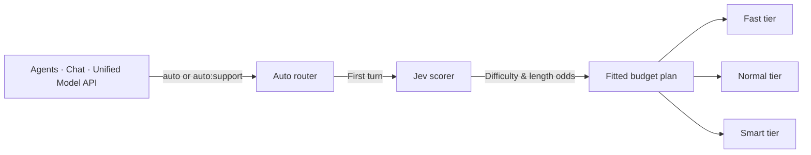

<!-- Renaming/deleting this file? Add a redirect in docs/redirects.json. -->

Send easy sessions to a cheap model and hard ones to a frontier model, while keeping daily spend near a target you pick. An auto router sits behind one model name, `auto` or `auto:<name>`, learns from its own traffic, and keeps each session on one model so prompt caches stay warm. Run one router for the whole organization or separate routers per team or customer, each with its own models, budget, and decision model.



If you want load balancing and failover across keys for a single model, use a [model pool](/docs/llm-proxy/model-pools) instead.

## How It Picks a Model

Jev does not pick the model. Jev scores the session's opening context, and Archestra's own routing plan uses those scores, your traffic history, model prices, and daily budget to choose the tier.

1. **Score the opening turn:** on a session's first request, Jev estimates two things: the probability that fast, normal, or smart is the weakest tier that can finish the whole session as well as a frontier model, and the chance that the session's context will grow past roughly 100,000 tokens.
2. **Estimate cost and quality per tier:** using a plan fitted from the router's past sessions, Archestra predicts how many tokens this kind of session tends to use, what share will hit long-context pricing, and what it would cost on each of your three models.
3. **Spend the budget where it buys the most quality:** the plan picks the tier that maximizes expected quality within your daily budget. Under a tight budget, only sessions where a stronger model buys the biggest quality gain per extra dollar move up a tier; under a larger budget, more sessions do.
4. **Stay on that model for the session:** follow-up turns reuse the saved choice without calling Jev again.

## Set It Up

You need [`llmProxy:update`](/docs/reference/permissions#llmProxy:update) to create or edit routers and [`llmProxy:read`](/docs/reference/permissions#llmProxy:read) to view them.

1. Add a Jev API key shared with the whole organization under [Model Providers](/docs/llm-proxy/providers#jev). Jev scores each new session.
2. Go to **LLM → Auto Routing** and click **Create auto router**.
3. Give it a name. Clients request `auto:` followed by that name, such as `auto:support`. The first router is named `auto`.
4. Pick an organization-wide provider key and model for each of the three tiers: fast, normal, and smart. Each tier can use a different provider.
5. Pick a daily budget and the decision model.
6. Turn auto routing on under **Settings → LLM**. This switch covers every router in the organization.

Open a router to check its current plan: expected spend against the budget, quality relative to sending everything to the smart model, and the planned split across fast, normal, and smart. Switch to **7 days** or **14 days** to see what it actually routed: billed spend, sessions and requests, actual tier split, and estimated savings against the smart model at list price.


## Call a Router

Use an auto router from Archestra agents and chats, or from your own apps over the [Unified Model API](/docs/llm-proxy/unified-model).

- **Agents and chats:** pick a router in the agent form or chat model list, where `auto` shows as **Auto** and `auto:support` as **Auto · support**. To route everything without a model of its own, set a router as the **Default Model for Agents and New Chats** under **Settings → Agents**.
- **Apps:** add the router under **Auto routers** on a [standard virtual key](/docs/llm-proxy/authentication#standard-virtual-keys) or an [OAuth client](/docs/llm-proxy/authentication#call-as-the-app). A credential can call only the routers granted to it and gets `403` for any other. Granted routers appear in `/v1/unified-model/models` and work on `/v1/unified-model/chat/completions` and `/v1/unified-model/responses`.

:::tabs
@tab curl
```bash
curl "https://<archestra-host>/v1/unified-model/chat/completions" \
  -H "Authorization: Bearer $ARCHESTRA_VIRTUAL_KEY" \
  -H "Content-Type: application/json" \
  -H "X-Archestra-Session-Id: support-ticket-4821" \
  -d '{
    "model": "auto:support",
    "messages": [{"role": "user", "content": "Why did my invoice double this month?"}]
  }'
```

@tab Python
```python
from openai import OpenAI

client = OpenAI(
    base_url="https://<archestra-host>/v1/unified-model",
    api_key="<virtual-key>",
)

response = client.chat.completions.create(
    model="auto:support",
    messages=[{"role": "user", "content": "Why did my invoice double this month?"}],
    extra_headers={"X-Archestra-Session-Id": "support-ticket-4821"},
)
```

@tab TypeScript
```typescript
import OpenAI from "openai";

const client = new OpenAI({
  baseURL: "https://<archestra-host>/v1/unified-model",
  apiKey: process.env.ARCHESTRA_VIRTUAL_KEY,
});

const response = await client.chat.completions.create(
  {
    model: "auto:support",
    messages: [{ role: "user", content: "Why did my invoice double this month?" }],
  },
  { headers: { "X-Archestra-Session-Id": "support-ticket-4821" } },
);
```
:::

The request runs on the provider key of the tier the router picks, and the answer appears under **Logs → LLM Proxy** marked **auto→**.

- Native provider routes (`/v1/anthropic`, `/v1/openai`, and others) return `400` for router names. Clients that use a native route, such as Claude Code on Anthropic, cannot call an auto router directly.
- An agent or chat with an explicit model or model pool is never routed, and Agent Runtime agents are not routed. A [forked subagent](/docs/agents/subagents#fork-the-agent) of a routed agent uses the same router only when it runs on **Normal**.
- Each tier points to one provider key and model, so it does not fail over to another key the way a model pool does.

## Daily Budget and Presets

The daily budget is the average daily spend a router aims for, not a hard ceiling; spend on a busy day can run above it. To block requests at a strict cap, [add a spend limit](/docs/llm-proxy/cost-controls/limits#create-a-limit) under **Limits** for the team or virtual keys that call the router.

Pick a preset and Archestra derives the budget from the router's recent traffic, then updates it every time the plan refits:

- **Cost-efficient:** the highest spend where the fast model still serves two thirds of sessions.
- **Intelligence:** the lowest spend where the smart model serves two thirds of sessions.
- **Balanced:** halfway in cost between the two.
- **Custom:** a fixed daily target in USD.

Once a router has history, **Configure** previews the estimated daily spend and fast/normal/smart tier split on today's traffic as you switch presets or edit a custom budget.


### Decision Model

Each router chooses a decision-model provider, one of its organization-wide keys, and a model. Jev is the only supported provider. Changing the decision model resets what that router has learned.

## How Sessions Stay Sticky

A session with an explicit session ID is routed once on its first request and stays on that model until the session ends.

- **Sending a session ID:** pass `X-Archestra-Session-Id` from your own apps. It is required when continuing a `/v1/unified-model/responses` conversation with `previous_response_id`; omitting it returns `400`. Archestra also reads the session IDs that Open WebUI, Codex, OpenCode, Pi, and Claude send.
- **Without a session ID:** Archestra derives the session from the virtual key, the first user message, the initial system instructions, and the tool names. Changing the initial instructions or tool list gets a new routing decision.
- **What gets sent to the scorer:** a clipped excerpt of the opening user message and system instructions, plus the tool names. Common API keys, bearer tokens, and long opaque secrets are redacted first. Tool descriptions, schemas, tool results, and follow-up turns are never sent.

A background job builds a versioned routing plan from each router's past sessions. Editing a router triggers a new plan within about a minute, and every router refits at least once a day.

## Test and Simulate Through the API

Before shifting production traffic or changing a budget, test routing choices and what-if plans through the [Auto Routing API](/docs/reference/api/llm-proxy/auto-routing) without executing an LLM call or publishing a plan.

- **Dry-run a prompt ([`POST /api/auto-routing/routers/{id}/preview`](/docs/reference/api/llm-proxy/auto-routing#tag/auto-routing/POST/api/auto-routing/routers/{id}/preview)):** scores either plain opening `text` or a full opening Chat Completions, Responses, or Anthropic Messages `request` body (including its system prompt and tools) against the active plan, without calling the target model or saving a decision. Needs [`llmProxy:update`](/docs/reference/permissions#llmProxy:update).
- **Simulate a budget or traffic change ([`POST /api/auto-routing/routers/{id}/simulate`](/docs/reference/api/llm-proxy/auto-routing#tag/auto-routing/POST/api/auto-routing/routers/{id}/simulate)):** fits a candidate plan for a different daily budget, preset, or scaled traffic volume (`volumeMultiplier`) without publishing it. Needs [`llmProxy:read`](/docs/reference/permissions#llmProxy:read).
- **Inspect or refit a plan:** use [`GET /api/auto-routing/routers/{id}/diagnostics`](/docs/reference/api/llm-proxy/auto-routing#tag/auto-routing/GET/api/auto-routing/routers/{id}/diagnostics) to see per-session routes at a target budget, or [`POST /api/auto-routing/routers/{id}/replan`](/docs/reference/api/llm-proxy/auto-routing#tag/auto-routing/POST/api/auto-routing/routers/{id}/replan) to trigger a fresh plan fit immediately.

```bash
curl -X POST "https://<archestra-host>/api/auto-routing/routers/<router-id>/preview" \
  -H "Authorization: Bearer $ARCHESTRA_API_TOKEN" \
  -H "Content-Type: application/json" \
  -d '{"text": "Refactor this Rust async parser to avoid cloning buffers on every frame."}'
```

## Learning From Past Sessions

A router learns from past proxy traffic only when its **Overview** has a **Past sessions** card: the `auto` router of an organization that used Auto Routing before it could hold several routers. Every router you create starts cold. For the `auto` router, past sessions can bootstrap a plan immediately instead of waiting for live `auto` traffic.

Both steps run from the **Past sessions** card, which lists each run and what it cost.

1. **Find past sessions.** Runs on its own when you first enable auto routing, and again when you click **Score** and the last count is more than a day old. It reads the last 35 days of proxy logs and counts the sessions a plan can learn from, by API and client. It costs nothing.
2. **Score them.** You start this with **Score**, which shows what was found and the estimated cost before anything is sent. Archestra sends the opening prompt and context from each sampled session's logged first request to the Jev scorer, up to the spending limit you set, then fits a plan. The limit is checked against estimated cost, so actual charges can run slightly over it. **Stop** ends a run early, and the sessions it already scored still count.

Only sessions with a client-supplied session ID that began inside the window are used, and sessions whose content was not logged or is end-to-end encrypted are skipped. After a decision-model change, the old scores stop counting, and the router uses its normal model until enough live or past sessions are scored again.

## When It Falls Back to the Normal Model

Archestra routes a session to the router's normal model whenever it cannot make a reliable decision, and keeps that fallback for the rest of the session.

| Condition | What happens |
| --- | --- |
| **Cold start** | The router has fewer finished sessions than [`ARCHESTRA_AUTO_ROUTING_MIN_SESSIONS`](/docs/admin/deployment/configuration#ARCHESTRA_AUTO_ROUTING_MIN_SESSIONS). |
| **No valid plan** | No plan has been published yet, or the active plan is stale because the tier models or their prices changed. |
| **Scorer error or timeout** | Jev fails, is unreachable, or exceeds [`ARCHESTRA_AUTO_ROUTING_SCORER_TIMEOUT_MS`](/docs/admin/deployment/configuration#ARCHESTRA_AUTO_ROUTING_SCORER_TIMEOUT_MS). |
| **No user text** | The request has no user text to score, such as Bedrock Converse payloads. |
| **Incompatible tier model** | In Chat or Archestra agents, a router with a Responses-only model in any tier skips routing and runs on the normal model. |
| **Router disabled or incomplete** | Auto routing is turned off, a tier is unset, or the organization has no Jev key. Agents and chats on the router run on the normal model without scoring. |

## Inspect Decisions and Savings

Open [Logs](/docs/insights/logs) under **Logs → LLM Proxy** to see why a request got its model. Auto-routed rows are marked **auto→**; opening one shows **Auto routing** with the router name, how the scorer rated the task for each tier, the tier picked and why, and the estimated savings against the smart model.

To read the saved decision programmatically without calling the scorer again, call [`GET /api/llm-proxy-logs/{logId}/auto-routing`](/docs/reference/api/llm-proxy/logs#tag/llm-proxy-logs/GET/api/llm-proxy-logs/{logId}/auto-routing). It returns the router, chosen model and tier, routing reason, and expected cost.

Estimated savings compare billed tokens against what those same tokens would have cost on the smart model at list price. Requests covered by a subscription count toward sessions and requests, but add no spend and no savings.

## Long-Context Prices

Some models charge higher rates past a prompt-length threshold. On a model's settings under **Models**, set the threshold and its four long-context prices so routing plans and cost reports price long prompts accurately. Those prices apply to all traffic on that model, not only auto routing.

## What to Know

- Routing decisions are kept for 90 days. After that, the same session ID is scored and routed again as a new session.
- Deleting a router removes its plans and learned history; agents and chats assigned to it fall back to their own model.
- Every routed request still runs through your existing [cost limits](/docs/llm-proxy/cost-controls) and [Guardrails](/docs/agents/guardrails).
