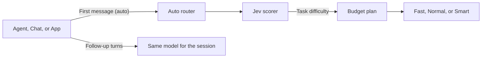

<!-- Renaming/deleting this file? Add a redirect in docs/redirects.json. -->
<!-- Check docs writer skill at .agents/skills/archestra-docs-writer/SKILL.md -->

When a team starts using AI agents or chat at work, almost everyone points them at the biggest, most expensive model. It makes sense: nobody wants an agent to get stuck halfway through a hard task. The catch is that most sessions aren't hard. Much of the day goes to summarizing a thread, fixing a typo, or answering a quick question — work a faster, cheaper model handles just as well.

The usual fixes each have a catch. Asking people to switch models by hand rarely sticks. Putting everyone on a smaller model saves money until someone hits a hard coding or research task and loses trust in the tool. Writing your own routing rules means maintaining brittle thresholds that break every time a new model comes out or prices change.

**Auto Routing** is an [LLM Proxy](/docs/llm-proxy) feature that sends each session to a different model dynamically, invisibly to the AI agent or user. You pick three models — **Fast**, **Normal**, and **Smart** — and a daily budget. Instead of calling a specific model, your agents and apps ask for `auto` (or a named router like `auto:support`). Easy requests go to a faster, cheaper model to save budget; hard ones go to your frontier model. Each session is routed once on its first message and stays on that model until it finishes, so prompt caches stay warm and follow-up turns add no extra wait.



## How It Picks a Model

You don't tune weights or maintain per-turn rules. You pick three models and a daily budget, and Archestra learns the split from your own traffic.

1. **Check the first message:** when a session starts, Archestra sends a short excerpt of the opening prompt (with secrets stripped) to Jev. Jev estimates whether the fast, normal, or smart model is enough to finish the task at frontier quality, and how likely the conversation is to grow past roughly 100,000 tokens.
2. **Estimate what the session will cost:** using past sessions on the same router and the token prices set under **Models**, Archestra predicts how many tokens this kind of session tends to use, how much of the prompt gets cached, and what it would cost on each of your three models.
3. **Spend the budget where it matters most:** the routing plan upgrades sessions where a stronger model buys the biggest jump in quality per extra dollar. Under a tight budget, only the hardest sessions move up; under a larger budget, more of them do.
4. **Stay on that model:** every follow-up turn in the session goes straight to the chosen model without calling Jev again, keeping prompt caches warm.

## Set It Up

You need [`llmProxy:update`](/docs/reference/permissions#llmProxy:update) to create or edit routers and [`llmProxy:read`](/docs/reference/permissions#llmProxy:read) to view them.

1. Add an organization-wide Jev API key under [Model Providers](/docs/llm-proxy/providers#jev).
2. Go to **LLM → Auto Routing** and click **Create auto router**.
3. Give it a name. Clients request `auto:` followed by that name, such as `auto:support`; leave it empty to name the router `auto`.
4. Pick an organization-wide provider key and model for each tier: **Fast**, **Normal**, and **Smart**. The tiers can be on different providers — for example, Haiku or Gemini Flash for Fast, Sonnet or GPT for Normal, and Opus or a reasoning model for Smart.
5. Choose a budget preset or a custom daily target in USD, and pick the decision model.
6. Turn auto routing on under **Settings → LLM**. This switch covers every router in the organization.

Open a router to see its current plan: expected daily spend against your budget, quality relative to sending everything to the smart model, and the planned split across Fast, Normal, and Smart. Switch to **7 days** or **14 days** to see billed spend, the actual tier split, and estimated savings compared to running everything on the smart model.


## Call a Router

You can point Archestra agents, chats, OpenAI-compatible coding agents, or your own apps at a router over the [Unified Model API](/docs/llm-proxy/unified-model).

- **Agents and chats:** pick **Auto** (`auto`) or **Auto · `<name>`** (`auto:<name>`) in the agent form or chat model list, or set a router as the **Default Model for Agents and New Chats** under **Settings → Agents**.
- **Coding agents:** add the router under **Auto routers** on a [standard virtual key](/docs/llm-proxy/authentication#standard-virtual-keys), then point clients like OpenCode, Kilo, Codex, or Open WebUI at `/v1/unified-model` with model `auto` or `auto:<name>`. Archestra reads their session IDs automatically.
- **Apps:** add the router under **Auto routers** on a standard virtual key or an [OAuth client](/docs/llm-proxy/authentication#call-as-the-app). Granted routers show up in `/v1/unified-model/models` and work on `/v1/unified-model/chat/completions` and `/v1/unified-model/responses`. Calling a router the credential doesn't have access to returns `403`.

:::tabs
@tab curl
```bash
curl "https://<archestra-host>/v1/unified-model/chat/completions" \
  -H "Authorization: Bearer $ARCHESTRA_VIRTUAL_KEY" \
  -H "Content-Type: application/json" \
  -H "X-Archestra-Session-Id: support-ticket-4821" \
  -d '{
    "model": "auto:support",
    "messages": [{"role": "user", "content": "Why did my invoice double this month?"}]
  }'
```

@tab Python
```python
from openai import OpenAI

client = OpenAI(
    base_url="https://<archestra-host>/v1/unified-model",
    api_key="<virtual-key>",
)

response = client.chat.completions.create(
    model="auto:support",
    messages=[{"role": "user", "content": "Why did my invoice double this month?"}],
    extra_headers={"X-Archestra-Session-Id": "support-ticket-4821"},
)
```

@tab TypeScript
```typescript
import OpenAI from "openai";

const client = new OpenAI({
  baseURL: "https://<archestra-host>/v1/unified-model",
  apiKey: process.env.ARCHESTRA_VIRTUAL_KEY,
});

const response = await client.chat.completions.create(
  {
    model: "auto:support",
    messages: [{ role: "user", content: "Why did my invoice double this month?" }],
  },
  { headers: { "X-Archestra-Session-Id": "support-ticket-4821" } },
);
```
:::

The request runs on whichever provider key backs the chosen tier, and shows up under **Logs → LLM Proxy** marked **auto→**.

Native provider routes (`/v1/anthropic`, `/v1/openai`, and others) return `400` for router names, so clients tied to a native route can't call an auto router directly.

| Feature | Use when | Failover |
| --- | --- | --- |
| **Auto router** | You want each session routed across fast, normal, and smart models within a daily budget | One provider key per tier |
| **[Model pool](/docs/llm-proxy/model-pools)** | You want load balancing or failover across several provider keys for one model name | Fails over across keys in the pool |

## Daily Budget and Presets

The daily budget is an average target, not a hard cutoff — on a busy day, spend can run above it. If you want to block requests once a strict cap is hit, [add a spend limit](/docs/llm-proxy/cost-controls/limits#create-a-limit) under **Limits** for the team or virtual keys calling the router.

Pick a preset and Archestra calculates the budget from the router's recent traffic, updating it each time the plan refits:

- **Cost-efficient:** the highest spend where the fast model still handles two thirds of sessions.
- **Intelligence:** the lowest spend where the smart model handles two thirds of sessions.
- **Balanced:** halfway in cost between the two.
- **Custom:** a fixed daily target in USD.


<span id="decision-model"></span><span id="test-and-simulate-through-the-api"></span><span id="learning-from-past-sessions"></span>

## Preview and Simulate Before Rollout

Before you shift traffic or change a budget, you can check what the router would pick and what it would cost.

- **Preview in the UI:** once a router has history, switching presets or editing a custom budget on **Configure** previews expected daily spend and the Fast / Normal / Smart split on today's traffic before you save.
- **Dry-run a prompt ([`POST /api/auto-routing/routers/{id}/preview`](/docs/reference/api/llm-proxy/auto-routing#tag/auto-routing/POST/api/auto-routing/routers/{id}/preview)):** scores plain opening `text` or a full opening Chat Completions, Responses, or Anthropic Messages `request` body against the active plan without calling the target model or saving a decision. Needs [`llmProxy:update`](/docs/reference/permissions#llmProxy:update).
- **Simulate a budget or traffic shift ([`POST /api/auto-routing/routers/{id}/simulate`](/docs/reference/api/llm-proxy/auto-routing#tag/auto-routing/POST/api/auto-routing/routers/{id}/simulate)):** fits a candidate plan for a different daily budget, preset, or scaled traffic volume (`volumeMultiplier`) without publishing it. Needs [`llmProxy:read`](/docs/reference/permissions#llmProxy:read).
- **Inspect or refit a plan:** call [`GET /api/auto-routing/routers/{id}/diagnostics`](/docs/reference/api/llm-proxy/auto-routing#tag/auto-routing/GET/api/auto-routing/routers/{id}/diagnostics) to see per-session routes at a target budget, or [`POST /api/auto-routing/routers/{id}/replan`](/docs/reference/api/llm-proxy/auto-routing#tag/auto-routing/POST/api/auto-routing/routers/{id}/replan) to trigger a fresh fit right away.

```bash
curl -X POST "https://<archestra-host>/api/auto-routing/routers/<router-id>/preview" \
  -H "Authorization: Bearer $ARCHESTRA_API_TOKEN" \
  -H "Content-Type: application/json" \
  -d '{"text": "Refactor this Rust async parser to avoid cloning buffers on every frame."}'
```

## How Sessions Stay Sticky

A session is routed once on its first request and stays on that model for up to 90 days.

- **Sending a session ID:** pass `X-Archestra-Session-Id` from your own apps. It's required when continuing a `/v1/unified-model/responses` conversation with `previous_response_id`; leaving it out returns `400`. Archestra reads the session IDs sent by Open WebUI, Codex, OpenCode, Pi, and Claude automatically.
- **Without a session ID:** Archestra derives one from the virtual key, opening user message, initial instructions, and tool names.
- **Plan updates and privacy:** a background job fits a new plan from completed sessions at least once a day, and within about a minute after you edit a router. Changing the decision model resets what that router has learned. Only a short opening excerpt and tool names (with secrets redacted) go to Jev — tool schemas, tool results, and follow-up turns are never sent.

## Inspect Decisions and Savings

Open [Logs](/docs/insights/logs) under **Logs → LLM Proxy** to see why a session got its model and how much it saved. Auto-routed rows are marked **auto→**; opening one shows **Auto routing** with the router name, scorer odds, chosen tier and reason, and estimated savings against the smart model at list price.

To read the saved decision from code without calling the scorer again, call [`GET /api/llm-proxy-logs/{logId}/auto-routing`](/docs/reference/api/llm-proxy/logs#tag/llm-proxy-logs/GET/api/llm-proxy-logs/{logId}/auto-routing). Requests covered by a subscription count toward sessions and requests, with no billed spend and no savings.

<span id="when-it-falls-back-to-the-normal-model"></span><span id="long-context-prices"></span>

## What to Know

- **Normal-tier fallback:** during cold start (until a router reaches [`ARCHESTRA_AUTO_ROUTING_MIN_SESSIONS`](/docs/admin/deployment/configuration#ARCHESTRA_AUTO_ROUTING_MIN_SESSIONS) scored sessions), while a plan is refitting, or if Jev fails or exceeds [`ARCHESTRA_AUTO_ROUTING_SCORER_TIMEOUT_MS`](/docs/admin/deployment/configuration#ARCHESTRA_AUTO_ROUTING_SCORER_TIMEOUT_MS), sessions fall back to the normal model automatically.
- **Limits and Guardrails:** every routed request still passes through your existing [cost limits](/docs/llm-proxy/cost-controls) and [Guardrails](/docs/agents/guardrails).
- **Deleting a router:** removes its plans and learned history; agents and chats assigned to it fall back to their own model.
