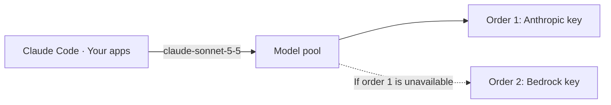

<!-- Renaming/deleting this file? Add a redirect in docs/redirects.json. -->

Keep a model answering when one provider key hits its rate limit or goes down. A model pool serves one model name, such as `claude-sonnet-5-5`, from several provider keys: Anthropic first, and Bedrock when Anthropic fails. Clients keep asking for `claude-sonnet-5-5` with the key they already have, and Archestra moves to the next key before they see an error.

## Create a Pool

A pool is a model name and its members. Each member is a shared provider key and the model ID that key uses, since providers spell the same model differently: Bedrock calls `claude-sonnet-5-5` `us.anthropic.claude-sonnet-5-5`.

Before you start, add a shared key for each provider on [Model Providers](/docs/llm-proxy/providers). Personal and subscription keys can't be members. Creating a pool needs [`llmModel:update`](/docs/reference/permissions#llmModel:update).

1. Go to **LLM → Model Pools** and click **Create pool**.
2. Under **Model name**, pick or type the name clients ask for.
3. Under **Members**, click **Add member**. Pick a **Provider key**, then the **Model** ID that key uses for this model. If the key has no synced models, type the ID.
4. Click **Add member** inside the same order to share its traffic. Click **Add order** to add a fallback.
5. Click **Create pool**.

The dialog then shows that the pool is ready, with a request you can copy. Send it, and the answer carries `x-archestra-pool: claude-sonnet-5-5` and `x-archestra-attempts: 1` headers.

- A pool named after a model ID takes over that model on the LLM Proxy: every request for `claude-sonnet-5-5` from a caller who can use the pool goes to the pool. Deleting the pool sends those requests back to the caller's own key. In chat and agents, a pool answers only when you [pick it](#use-a-pool-in-chat-and-agents).
- Switch a member off to stop sending it traffic and keep it in the pool.

## Order and Weight

Order sets which members a request tries first, and weight splits traffic between members that share an order. Order and weight work as in LiteLLM.

- **Order:** requests go to order 1. They go to order 2 only when every member of order 1 has failed or is cooling down. Drag a member into another order to move it, or between two orders to give it an order of its own.
- **Weight:** members of one order share its traffic by weight.

For example, a `gpt-6.1-sol` pool with an OpenAI key of weight 3 and an Azure AI Foundry key of weight 1 in order 1 sends 75% of requests to OpenAI and 25% to Azure. Add an Azure key in another region as order 2, and it answers only while both are unavailable.

## When a Member Fails

A request moves to the next member when a member fails before it starts to answer. The client sees an error only when the last member fails, or when the request itself is at fault.

| When the member | What happens |
| --- | --- |
| Answers `429` or a `5xx` error, or can't be reached | The request moves to the next member. |
| Answers `401`, `403`, or `404`, or its key can't be loaded | The request moves to the next member. The key was revoked, or it doesn't serve that model. |
| Stays silent: no first chunk of a stream within the [stream timeout](#timeouts-and-cooldown), or no full answer within the timeout | The request moves to the next member. |
| Rejects the request as invalid, such as a `400` | The error goes to the client. Other members would reject it too. |
| Fails after it starts to answer | The error goes to the client. A pool never switches members mid-answer. |

A failed member cools down for the pool's cooldown time. A longer `Retry-After` header extends it, up to 60 s or the cooldown time if that is longer. With no cooldown time set, the member cools down for 30 s, or for as long as its `Retry-After` header asks, up to 60 s. Other requests skip it while it cools down. The pool's members show **Cooling down** with the seconds left, and the reason on hover.

- The last member has nowhere to move to, so the pool doesn't time it out, and it gets the usual connection retries.
- When every member is cooling down, requests still try them, the one back soonest first.
- A conversation stays on the same member while that member is healthy, which keeps the provider's prompt cache warm.

### Timeouts and Cooldown

Set these under **Timeouts and cooldown** when you create or edit a pool. They apply to every member of the pool, and a blank one keeps its default. They are named after LiteLLM's `stream_timeout`, `timeout`, and `cooldown_time`.

| Setting | Default | What it sets |
| --- | --- | --- |
| **Stream timeout** | 30 s | How long a member may take to send the first chunk of a streamed answer. Up to 1800 s. |
| **Timeout** | Auto: 3 min plus 1 s per 20 tokens the request lets the model write, at most 30 min | How long a member may take to send a full answer that isn't streamed. Up to 1800 s. |
| **Cooldown time** | 30 s, or the `Retry-After` up to 60 s | The shortest time other requests skip a member that failed. Up to 3600 s. |

## Who Can Use a Pool

On the LLM Proxy, a pool is open to any credential that can already reach one of its members. People who connected through [Connect](/docs/get-started/connect) use the pool without changing anything, when their key is one of its members.

- A [standard virtual key](/docs/llm-proxy/authentication#standard-virtual-keys) that maps a member's provider key.
- An [OAuth client](/docs/llm-proxy/authentication#oauth-clients) whose provider keys include a member's key.

To let a virtual key or an OAuth client use a pool without mapping any of its members, add the pool under **Model pools** when you create or edit it. Only OAuth clients that [call as the app](/docs/llm-proxy/authentication#call-as-the-app) take pools. Setting **Model pools** needs [`llmModel:update`](/docs/reference/permissions#llmModel:update).

A caller who can't use a pool is not refused. Their request for that name goes to their own key, as it would without a pool.

## Use a Pool in Chat and Agents

In Archestra Chat and in agents, a pool answers only when you pick it. A provider key and a model run on that key alone, even when the key is a pool member.

- **Chat:** open the model menu, go to **Key**, and pick the pool under **Model pools**. The pool picks the member, so there is no model to choose.
- **Agents:** in the agent's form, pick the pool under **Model pools** in the key picker. An agent on an [Agent Runtime](/docs/agents/runtime) can't pick a pool. Its requests go through a pool when the agent's model has the pool's name and its provider key is one of the pool's members.

You see the pools that have a member on a key you can use.

## Connect a Client

Point a client at any of these endpoints and ask for the pool's name as the model. Click **Connect** on a pool, pick an **Endpoint** and how to **Sign in with**, and copy the base URL and the request.

| Endpoint | Base URL | Use it for |
| --- | --- | --- |
| **Model Router** | `https://<archestra-host>/v1/model-router` | Any OpenAI-compatible client. `/models` lists the pool under its plain name. |
| **Anthropic API** | `https://<archestra-host>/v1/anthropic` | Claude Code and the Anthropic SDK |
| **OpenAI API** | `https://<archestra-host>/v1/openai` | The OpenAI SDK, on Chat Completions |

Claude Code needs nothing for a pool named after a Claude model. For any other pool, pick it as the model, for example `claude --model gpt-6.1-sol`.

- **Context window:** Claude Code assumes a 200k context window for a model name it doesn't know. Set `CLAUDE_CODE_MAX_CONTEXT_TOKENS` to the smallest context window among the pool's members.
- **Members on another API:** Claude Code and OpenAI clients reach every member, whatever API its provider speaks. Archestra translates the request. Anthropic-only features, such as prompt caching hints and thinking blocks, are dropped on the way to a member that doesn't speak Anthropic's API. Claude models on Bedrock keep them.

## See Which Member Answered

Every attempt is a request in [Logs](/docs/admin/logs) under **Logs → LLM Proxy**, so a request that failed over shows each member it tried. Open a request to see its **Model pool**, the member's **Provider key**, the **Outcome** (**Answered**, **Failed over**, or **Failed**), and the **Reason**.

Each attempt is priced as the member that made it, with that member's provider and model ID:

- An attempt that was refused costs $0.
- An attempt that was cut off for being silent carries an estimated input cost, because the provider read the prompt and bills it.
- A member's model with no price in the catalog falls back to the default price. Set its price under **Models**, as for [custom models](/docs/llm-proxy/costs-and-limits#where-token-prices-come-from).

## Limits

- Clients on the OpenAI Responses API, such as OpenCode, can't use pools yet. That includes `/responses` on the Model Router.
- Members can be keys for Anthropic, AWS Bedrock, OpenAI, Azure AI Foundry, and OpenAI-compatible providers such as vLLM, OpenRouter, and Mistral AI. Gemini and Vertex AI keys can't be members yet.
- Timeouts and cooldown are set for the whole pool, not for one member. Pools don't route by a key's rate or token limits.
