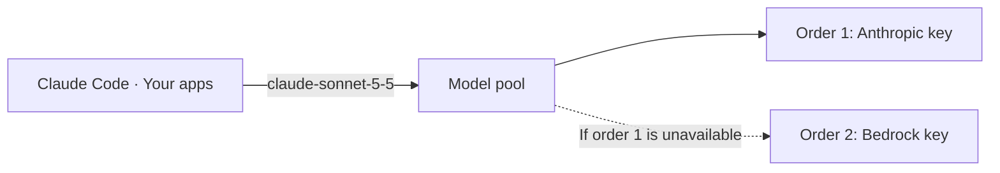

<!-- Renaming/deleting this file? Add a redirect in docs/redirects.json. -->

Keep a model answering when one provider key hits its rate limit or goes down. A model pool serves one model name, such as `claude-sonnet-5-5`, from several provider keys: Anthropic first, and Bedrock when Anthropic fails. Clients keep asking for `claude-sonnet-5-5` with the key they already have, and Archestra moves to the next key before they see an error.

## Create a Pool

A pool is a model name and its members. Each member is a provider connection and the model ID that connection uses, since providers spell the same model differently: Bedrock calls `claude-sonnet-5-5` `us.anthropic.claude-sonnet-5-5`.

Before you start, add provider keys or connect your subscriptions on [Model Providers](/docs/llm-proxy/providers). You can add shared connections and your own personal connections, including GitHub Copilot. Creating a pool needs [`llmModel:update`](/docs/reference/permissions#llmModel:update).

1. Go to **LLM → Model Pools** and click **Create pool**.
2. Under **Model name**, pick or type the name clients ask for.
3. Under **Members**, click **Add member**. Pick a **Provider key**, then the **Model** ID that key uses for this model. If the key has no synced models, type the ID.
4. Click **Add member** inside the same order to share its traffic. Click **Add order** to add a fallback.
5. Click **Create pool**.

The dialog then shows that the pool is ready, with a request you can copy. Send it, and the answer carries `x-archestra-pool: claude-sonnet-5-5` and `x-archestra-attempts: 1` headers. The pool name in `x-archestra-pool` is percent-encoded so custom names with spaces or Unicode are safe in HTTP headers.

- A pool named after a model ID takes over that model on the LLM Proxy: every request for `claude-sonnet-5-5` from a caller who can use the pool goes to the pool. Deleting the pool sends those requests back to the caller's own key. In chat and agents, a pool answers only when you [pick it](#use-a-pool-in-chat-and-agents).
- Switch a member off to stop sending it traffic and keep it in the pool.

## Order and Weight

Order is a member's priority, and weight splits traffic between members of the same priority. A pool picks a member by these two settings alone, not by load, latency, cost, or how much of a key's rate or token limit is left.

- **Order:** requests go to order 1. They go to order 2 only when every member of order 1 has failed or is cooling down. Drag a member into another order to move it, or between two orders to give it an order of its own.
- **Weight:** members of one order share its traffic by weight.

For example, a `gpt-6.1-sol` pool with an OpenAI key of weight 3 and an Azure AI Foundry key of weight 1 in order 1 sends 75% of requests to OpenAI and 25% to Azure. Add an Azure key in another region as order 2, and it answers only while both are unavailable.

## When a Member Fails

A request moves to another healthy member when one fails before it starts to answer, within the pool's [retries](#retries). The client sees an error when the last member fails, or when the request itself is at fault.

| When the member | What happens |
| --- | --- |
| Answers `429` or a `5xx` error, or can't be reached | The request moves to the next member. |
| Answers `401`, `403`, or `404`, or its key can't be loaded | The request moves to the next member. The key was revoked, or it doesn't serve that model. |
| Stays silent: no first chunk of a stream within the [stream timeout](#timeouts-and-cooldown), or no full answer within the timeout | The request moves to the next member. |
| Reports exhausted credit: `402`, OpenAI-compatible `429 insufficient_quota`, or Anthropic’s `400` credit-balance refusal | The request moves to the next member. The exhausted member is excluded until its cooldown expires. |
| Rejects another invalid request, such as a `400` | The error goes to the client. Other members would reject it too. |
| Fails after it starts to answer | The error goes to the client. A pool never switches members mid-answer. |

A member with a transient failure cools down for the pool's cooldown time. A longer `Retry-After` header extends it, up to 60 s or the cooldown time if that is longer. With no cooldown time set, the member cools down for 30 s, or for as long as its `Retry-After` header asks, up to 60 s. Other requests skip it while it cools down. The pool's members show **Cooling down** with the seconds left, and the reason on hover.

- The last member has nowhere to move to, so the pool does not time it out.
- Members cooling down are skipped. If every member is cooling down, the request fails with `503` without contacting a provider.
- A conversation stays on the same member while that member is healthy, which keeps the provider's prompt cache warm.

### Retries

Retries are always on. After a temporary failure, the pool selects a healthy deployment again. Change the counts and delays under **Failover** when you edit a pool; a blank field keeps its default, shown on hover of its help icon. Each selection uses order and weight: a healthy member in order 1 takes precedence over order 2.

- **Retries:** additional selections after the first, from 0 to 10; the default is 2. Members share this budget, rather than receiving that many attempts each. Once exhausted, each later order gets a separate fallback attempt and retry budget. Set 0 to skip additional selections within the current group, not to disable later-order fallbacks.
- **Retries by error type:** give connection errors, timeouts, rate limits, or server errors their own retry count. The first failure chooses the budget for that group or order fallback; switching members or encountering a different error does not reset it. Invalid requests are returned immediately; rejected credentials, missing models and exhausted credit move to later-order fallbacks.
- **Backoff:** starts at 500 ms, doubles up to 8000 ms, and uses 75–100% of that delay. A provider's positive `Retry-After` replaces the delay when within the maximum; longer waits move to a later order instead.

Under **Member overrides**, set a member's retries, delays or retries by error type for when that member has the first failure. Blank fields use the pool's values, and removing a member removes its override. A request can override every retry count with `x-archestra-num-retries: 0` through `10`; it cannot enable retries for permanent failures or after streaming output starts.

- A retry can select a later order when all lower-order members are cooling down. Once an explicit order fallback begins, its retries stay within that order.
- Cooling members are excluded from selections. If none are healthy, the request fails instead of replaying a cooling member. A pool with only one member gives it its bounded recovery attempts before putting it on cooldown.
- Each dispatched attempt appears in proxy logs and counts toward `x-archestra-attempts`. Retries can add latency and provider charges, especially after timeouts; set **Retries** to 0 to keep only order fallbacks.

## Timeouts and Cooldown

Set these under **Failover** when you edit a pool; a new pool starts with the defaults. They apply to every member of the pool, and a blank one keeps its default.

| Setting | Default | What it sets |
| --- | --- | --- |
| **Stream timeout** | 30 s | How long a member may take to send the first chunk of a streamed answer. Up to 1800 s. |
| **Timeout** | Auto: 3 min plus 1 s per 20 tokens the request lets the model write, at most 30 min | How long a member may take to send a full answer that isn't streamed. Up to 1800 s. |
| **Cooldown time** | 1 hour for exhausted credit; otherwise 30 s, or the `Retry-After` up to 60 s | The shortest time other requests skip a member that failed. Up to 3600 s. |

Credit exhaustion uses **Cooldown time** when set, including a shorter value for faster recovery after a top-up. Without an override, it waits one hour. Ordinary rate limits keep their shorter cooldown.

## Request Compatibility

A pool skips members whose known input types or estimated context limit cannot accept the request. For example, an image goes to an image-capable member instead of a known text-only member.

- Context checks include text, system instructions, tool definitions and results, plus the requested output allowance. Local token counts are estimates; media tokens and remote file contents are not counted.
- Members with missing metadata remain eligible. Azure input types use evidence for the selected provider key; Azure context checks are deferred until a scoped limit is available. Keep model capabilities and context limits accurate under **Models**.
- If no member qualifies, the request fails with `400` before contacting a provider. Skipping an incompatible member does not put it on cooldown.

## Who Can Use a Pool

A [standard virtual key](/docs/llm-proxy/authentication#standard-virtual-keys) uses a pool only after you add the pool under **Model pools** when you create or edit the key. The same goes for an [OAuth client](/docs/llm-proxy/authentication#oauth-clients) that [calls as the app](/docs/llm-proxy/authentication#call-as-the-app). Which provider keys the key or client maps doesn't matter: the pool answers with its members' keys. Remove the pool, and the key or client can no longer use it.

Credentials that have no pools of their own, such as people who signed in through [Connect](/docs/get-started/connect) or an identity provider's token, use a pool when they can already reach one of its members.

Personal members only serve requests authenticated as their owner, such as a personal virtual key or a signed-in user. A pool grant does not share a subscription: other callers skip personal members and use shared members. If none remain, the request fails with `403` before contacting a provider.

Setting **Model pools** needs [`llmModel:update`](/docs/reference/permissions#llmModel:update).

A caller who can't use a pool is not refused. Their request for that name goes to their own key, as it would without a pool.

## Use a Pool in Chat and Agents

In Archestra Chat and in agents, a pool answers only when you pick it. A provider key and a model run on that key alone, even when the key is a pool member.

- **Chat:** open the model menu, go to **Key**, and pick the pool under **Model pools**. The pool picks the member, so there is no model to choose.
- **Agents:** in the agent's form, pick the pool under **Model pools** in the key picker. An agent on an [Agent Runtime](/docs/agents/runtime) can't pick a pool. Its requests go through a pool when the agent's model has the pool's name and its provider key is one of the pool's members.

You see the pools that have a member on a key you can use.

## Connect a Client

Point a client at any of these endpoints and ask for the pool's name as the model. Click **Connect** on a pool, pick an **Endpoint** and how to **Sign in with**, and copy the base URL and the request.

| Endpoint | Base URL | Use it for |
| --- | --- | --- |
| **Unified Model API** | `https://<archestra-host>/v1/unified-model` | Any OpenAI-compatible client. `/models` lists the pool under its plain name. |
| **Anthropic API** | `https://<archestra-host>/v1/anthropic` | Claude Code and the Anthropic SDK |
| **OpenAI API** | `https://<archestra-host>/v1/openai` | The OpenAI SDK, on Chat Completions or Responses |

Claude Code needs nothing for a pool named after a Claude model. For any other pool, pick it as the model, for example `claude --model gpt-6.1-sol`.

- **Context window:** Claude Code assumes a 200k context window for a model name it doesn't know. Set `CLAUDE_CODE_MAX_CONTEXT_TOKENS` to the smallest context window among the pool's members.
- **Members on another API:** Claude Code and OpenAI Chat Completions clients reach every member, whatever API its provider speaks. Archestra translates the request. Anthropic-only features, such as prompt caching hints and thinking blocks, are dropped on the way to a member that doesn't speak Anthropic's API. Claude models on Bedrock keep them.

## See Which Member Answered

Every attempt is a request in [Logs](/docs/admin/logs) under **Logs → LLM Proxy**, named by the member key it went to. An attempt that failed over shows its status and reason, such as **429 · rate limited**, and the attempt after it is marked **Retry**. Open a request to see, under **Model pool**, each member it tried in order with its outcome and time, and the members it did not need.

Each attempt is priced as the member that made it, with that member's provider and model ID:

- An attempt that was refused costs $0.
- An attempt that was cut off for being silent carries an estimated input cost, because the provider read the prompt and bills it.
- A member's model with no price in the catalog falls back to the default price. Set its price under **Models**, as for [custom models](/docs/llm-proxy/costs-and-limits#where-token-prices-come-from).

## Limits

- Responses clients, including Codex and OpenCode, can use pools through `/responses` on the OpenAI or Unified Model API. Every enabled member must serve native Responses on OpenAI, Azure AI Foundry, or GitHub Copilot; other member providers are rejected rather than translated. Send the full conversation in `input`: Stored response, conversation, item, file, prompt, vector-store, container and skill references are not supported because they belong to one provider account. Use inline inputs and synchronous execution.
- Members can use credentials for Anthropic, AWS Bedrock, Gemini (including Vertex AI), OpenAI, Azure AI Foundry, and OpenAI-compatible providers such as vLLM, OpenRouter, and Mistral AI. OpenAI Chat Completions, Anthropic Messages, and native Gemini clients can mix these providers for text, inline images/PDFs, and client tool calls. Bedrock Converse clients require a Bedrock-only pool; incompatible members produce an error instead of being skipped.
- Provider-hosted tools, provider-specific cache references, custom Gemini safety settings, structured output, and non-text output are not portable across providers. Incompatible requests fail explicitly; use a pool on the original provider for those features. Reasoning budgets and private thought signatures do not transfer between providers. Each destination uses its own reasoning defaults, so leave room in the output limit for models that think before answering.
- Timeouts and cooldown are set for the whole pool, not for one member.
