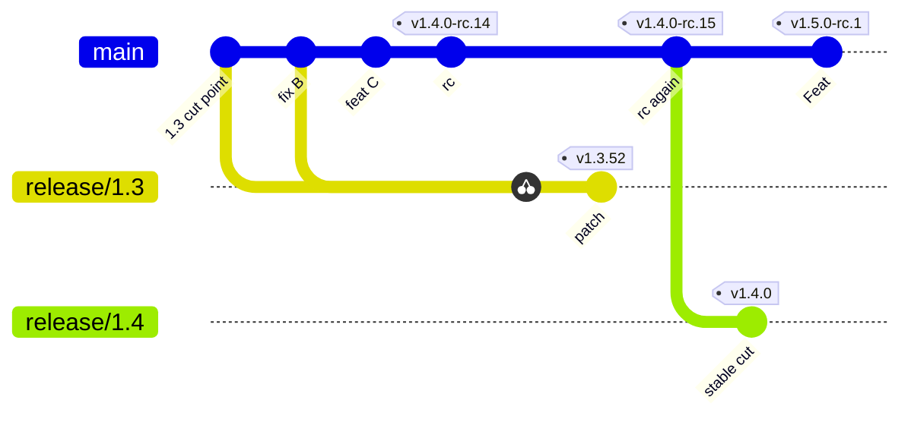

# Release Checklist

Archestra uses two release pipelines:
- **Release candidate (RC):** Automatic prereleases from `main` (for example, `1.4.0-rc.14`).
- **Stable:** Automatic releases from `release/X.Y` (for example, `1.3.52` or `1.4.0`).

[Release-please](https://github.com/googleapis/release-please-action#supporting-multiple-release-branches) manages versions and changelogs. GitHub Actions builds the artifacts. `archestra/platform:latest` follows the newest published release, RCs included, and never moves backward. Every other image's `latest` moves only on stable releases, because stable platforms reference the agent images by that tag.

## Image CVE Gate

Release Please PR updates on `main` and `release/X.Y` must pass image scanning before queue entry. Every update builds the Platform full/slim, MCP Server Base, and p4 Shim candidates from that event's synthetic merge commit. A successful scan applies only to that PR head, base, and merge candidate; a changed revision requires a new run. An API error, build error, scanner error, cancellation, or missing result blocks the gate. The policy remains fixable critical/high CVEs.

Ordinary PRs and merge groups report an explicit no-scan decision. Source/dependency security checks, builds, tests, and E2E checks still run under their existing policies. For an ad hoc byte scan, use **Docker Image Scanning** workflow dispatch with the exact E2E image SHA; the former `run-docker-scan` label does not trigger scans.

Release builds independently scan the exact immutable per-architecture digests before assigning version tags. This includes all published Platform, MCP, p4, Sandbox Base, and Agent Catalog images on both release tracks. Digest artifacts must come from the same workflow run and source revision and contain the complete expected architecture set. Release builds do not reuse previously tagged images or prior scan results. A failure prevents that image's version tag and blocks GitHub release publication; successful sibling builds and the prerelease chart may already exist, so use the existing same-run recovery procedure. Stable publication still requires separate artifact qualification and environment approval. Untagged build digests are uploaded before scanning so Scout can inspect them.

### Roll Out Required Checks

The workflow preserves `Docker Image Scanning (Platform)`, `Docker Image Scanning (MCP Server Base)`, `Docker Image Scanning (p4 Shim)`, and the historical literal `Docker Image Scanning (${{ matrix.name }})` contexts. Each depends on the always-running **Release Image Security** gate. A release scan skipped after a failed prerequisite cannot satisfy these contexts. No repository protection change is required to adopt this compatibility bridge.

1. Merge the workflow change through the current protections. Backport the release tooling to each supported stable branch through its normal protected PR process; changing `main` alone does not update an existing stable branch's workflows.
2. Verify the contexts on an ordinary PR, a Release Please PR update, and a merge group on each track. A release PR must perform real scans; a scan or classification failure must leave the gate and compatibility contexts failed.
3. In a separately approved settings change, replace only the legacy Docker scan contexts with **Release Image Security**, using the existing GitHub Actions integration. Preserve every unrelated required check and queue setting. Keep the compatibility jobs until all applicable rulesets have been read back and verified; remove them in a subsequent PR.

These workflow changes do not fix or suppress current vulnerabilities. Diagnose and repair any blocked release in a separate dependency or image PR.

### Transition From Beta To RC

The next release after `1.4.0-beta.13` uses temporary `release-as: 1.4.0-rc.14` with `prerelease-type: rc`.
Changing only `prerelease-type` does not replace an existing beta suffix in Release Please.
Keep the manifest and published beta versions unchanged until the generated RC release PR updates them.
After `1.4.0-rc.14` publishes, remove only `release-as` so rolling releases continue at `1.4.0-rc.15`.
RCs publish after successful builds and move only `archestra/platform:latest`. Neither release channel uses a GitHub environment or a separate deployment approval.



## Release A Candidate

If a breaking commit makes Release Please propose a new major version during an RC
track, set a temporary `packages.platform.release-as` in
`.github/release-please/release-please-config.json` to the next unpublished RC on the
intended track. For example, after `1.4.0-rc.35`, use `1.4.0-rc.36`.
Merge the configuration PR and verify the existing release PR updates its version
while retaining the breaking-change notes. After that RC publishes, remove only
`release-as`; the workflow pauses new release PRs while the override matches the
manifest.

1. [ ] Open the release-please PR on `main` (for example, `1.4.0-rc.14`).
2. [ ] Review the changelog and confirm checks pass, including migration upgrades from the active stable line.
3. [ ] Merge the PR and confirm the **Release Please** workflow publishes the RC release.

## Ship A Stable Fix

1. [ ] Land the fix on `main` first. The fix ships automatically in the next RC.
2. [ ] Add the label `backport release/X.Y` for each configured target (for example, `backport release/1.3`).
   - Add the label before or after the main PR merges.
   - Pushes to `main` and backport labels added after merge trigger processing without waiting for the scheduled scan.
   - A five-minute schedule retries outstanding requests. GitHub can delay scheduled runs; the interval is not a delivery guarantee.
   - **Open Backport PRs** cherry-picks the merged commit with `-x` and opens a separate PR per target.
   - The automation opens PRs; it never merges them. Merging a release PR authorizes automatic publication after successful builds.
3. [ ] Review each generated backport PR, confirm its checks pass, then add it to that branch's merge queue.
   - Only include necessary bug fixes. Do not include new features, refactors, or schema migrations.
   - Conflicts and schema changes produce a manual-action comment instead of a pushed backport.
   - Never merge `main` into a release branch.
   - Review the migration compatibility check. A green result does not permit schema migrations in a stable fix.
   - A migration backport is only permissible under the prefix rule below; in practice stable fixes ship without migrations.
4. [ ] Merge the generated release-please patch PR on `release/X.Y` (for example, `1.3.52`).
5. [ ] Complete **Verify Stable Publication** below. Publication runs automatically after the builds; finish qualification before merging the release PR.

### Backport Targets And Recovery

`.github/backport-targets.json` is the explicit list of branches that accept automatic backport requests.
Add each new stable or candidate branch there, and create its `backport release/X.Y` label.
Remove retired branches from that list when making them read-only.
The workflow always runs trusted automation from the default branch, including manual retries.
Automatic backports only accept merged PRs from branches in this repository targeting the default branch.
PRs from forks are ineligible, including through scheduled scans and manual retries.
Each automatic run scans all outstanding labels, so overlapping triggers can share one job.

Use **Open Backport PRs → Run workflow** to retry a merged main PR.
Supply its number and, optionally, one configured target branch.
An existing backport PR, including a closed PR, is not duplicated or reopened.
Label requests remain discoverable after workflow outages. Remove the request label when abandoning a backport.
An existing backport branch is never force-pushed or reset.
A push that succeeded before PR creation failed can resume if its source provenance matches.

For conflicts, create a manual branch from the release target and resolve the cherry-pick:

```bash
git checkout -b backport/fix-name origin/release/X.Y
git cherry-pick -x <main-commit-sha>
```

Open a PR against `release/X.Y` and complete the same review and release checks.
A schema migration is not eligible for automatic backporting; prepare a stable fix without it.

The workflow uses the existing release GitHub App token so generated PRs trigger CI.
Backport PRs receive the usual reviewer assignment and run checks even though the release App authored them.

## Migration Compatibility Across Release Tracks

A higher application version does not guarantee a compatible migration history.
Drizzle runs migrations newer than the database's latest recorded journal timestamp.
A stable backport can advance that timestamp past beta-only migrations.
The next beta upgrade can then report success while required columns remain missing.

Every deployed stable version must upgrade cleanly to the next stable patch, to
any later beta, and to the next stable line. The rule that guarantees this is
the **prefix rule**: a stable branch's migration history must remain a prefix
of main's, matching migrations by SQL content so renamed backports count.
Backport a migration only when every earlier main migration is already on the
stable branch. While the rule holds, upgrading any stable release applies
exactly the remaining suffix of main's history in canonical order, so schema
and data migrations converge with every other upgrade path.

PR validation checks upgrades within a release line and from stable to main.
Backport PRs also check their resulting stable history against main.
Release creation repeats the check against the current branch refs.
Keep these guards on both main and the active stable branch.

PR validation also replays the real upgrade. Backend `test:migration-upgrades`
migrates a database with each active stable line's latest released migration
history, upgrades it to the PR's history with the real Drizzle migrator, and
requires the schema to match a fresh install, no migration to apply twice, and
pre-existing data to survive.

The checker recognizes identical SQL under different backport filenames.
It rejects migrations that would be skipped or replayed, and missing source SQL.
It does not validate SQL semantics, dependency order, or database lock safety.
Continue testing the actual upgrade against the saved release artifacts.

If a published release already created a gap:

1. Add a new idempotent repair on main, newer than both migration histories.
2. Cover every skipped change and preserve values on already-migrated databases.
3. Register the reviewed SQL hashes in `backend/src/database/migrations/upgrade-repairs.json`.
4. Test with the real Drizzle migrator, including a database whose ledger already advanced past the gap.
5. Publish the repaired beta before directing affected stable installations to that beta.

Do not edit shipped migration SQL, renumber its timestamps, or rewind a database's migration ledger.
The ordinary backend test snapshot executes SQL directly and cannot detect timestamp-based skips.
See [migration upgrade checks](../backend/src/database/migrations/README.md) for commands and repair coverage rules.

## Cut A New Stable Feature Line

This is a complete cutover. Once the new stable release publishes, it becomes the only supported stable line and the previous line becomes read-only. The release operator or release agent completes all GitHub configuration and pull-request steps; contributors do not need to change their workflow.

1. [ ] Choose a tested RC tag (for example, `platform-v1.4.0-rc.14`). Confirm it is a published prerelease on `main` and passed qualification. Reconcile any existing target branch, tag, draft release, release PR, queue ruleset, and candidate workflow before continuing: resume only exact, protected state for that RC commit; never recreate objects or overwrite ambiguous state.
2. [ ] Get explicit approval for the stable cut. State the RC tag, `X.Y.0` version, new branch, previous line that will become EOL, repository-setting changes, and PRs that will be created and merged.
3. [ ] If the live `release/*` required-check rule blocks branch creation, temporarily set only `do_not_enforce_on_create: true` under the approved setting changes. Preserve the original ruleset payload and arrange restoration before changing it. If branch creation or any following verification fails, restore and read back the original ruleset before stopping.
4. [ ] Create `release/1.4` from that tag (not from `main`), then immediately restore and verify the original core ruleset:
   ```bash
   git checkout -b release/1.4 platform-v1.4.0-rc.14
   git push origin release/1.4
   ```
5. [ ] Before merging any PR, configure and verify GitHub protections:
   - The live `release/*` core ruleset applies and matches `main` for pull requests, required checks, deletion, non-fast-forward protection, and bypass actors.
   - An exact `release/1.4` ruleset has the same merge-queue parameters and bypass actors as `main`. GitHub does not support a merge queue on the wildcard ruleset.
   - Derive settings from the live rulesets. Do not hard-code ruleset IDs, check names, integration IDs, reviewer IDs, or queue parameters.
6. [ ] Open a PR to `release/1.4` configuring `.github/release-please/release-please-config.json` with the **Stable cut** settings below. Merge it through the new queue.
7. [ ] Inventory open `release/1.3` PRs. Recreate still-required fixes that already landed on `main` as `cherry-pick -x` backports to `release/1.4`, merge them, and wait for the release PR to update.
8. [ ] Verify the generated `1.4.0` release PR and its required checks. Complete qualification before merging: publication will run automatically after successful builds.
9. [ ] Before merging that release PR, retire the previous stable line under the stable-cut approval:
   - Confirm no `release/1.3` release workflow is running or waiting for approval, then close its remaining PRs with an EOL explanation.
   - Delete its exact merge-queue ruleset.
   - Add an exact active EOL ruleset that blocks updates to `release/1.3`, has no bypass actors, and sets `update_allows_fetch_and_merge: false`.
   - Keep its branch, tags, releases, images, and charts for reproducibility.
10. [ ] Verify the old line rejects updates, merge the `1.4.0` release PR through the queue, and complete **Verify Stable Publication**. The stable-cut approval covers this planned merge and its automatic publication.
11. [ ] Open and merge a PR that removes `release-as` from `release/1.4`. Future patches become `1.4.1`, `1.4.2`, etc.
12. [ ] Get separate explicit approval to cut `1.5.0-rc.1`. State the current `main` SHA and the configuration and release PRs that will be merged.
13. [ ] On `main`, open and merge a PR setting the **Next RC** configuration below. Merge the generated `1.5.0-rc.1` release PR through the queue.
14. [ ] Confirm the RC published and moved only `archestra/platform:latest`, then open and merge a PR removing `release-as` from `main`. Confirm rolling RC PRs resume.

The operator or release agent must create, queue, monitor, and verify these PRs and settings directly. Human actions are limited to the two explicit cut approvals, reviewer selection when it cannot be derived safely, and exceptional recovery decisions.

### Release Please Configuration

Edit `packages.platform` in `.github/release-please/release-please-config.json`:

| Field | Stable cut (`release/1.4`) | Next RC (`main`) |
| --- | --- | --- |
| `versioning` | `always-bump-patch` | `prerelease` |
| `prerelease` | `false` | `true` |
| `prerelease-type` | Remove field | `rc` |
| `release-as` (temporary) | `1.4.0` | `1.5.0-rc.1` |
| `draft` | `true` | `true` |

`draft: true` creates a draft GitHub release. It does not make the pull request a draft.

## Verify Stable Publication

Merging a release PR on `release/X.Y` builds and publishes the release automatically. There is no post-build manual qualification window. Complete required checks and release qualification before merging; keep image CVE checks and migration checks enabled.

1. [ ] Confirm all build jobs and **Publish release** completed successfully.
2. [ ] Download the `release-helm-chart` and `release-image-*` workflow artifacts for verification.
3. [ ] Install the saved chart in a test environment with `ARCHESTRA_BETA=false`. Confirm image digests match the build.
4. [ ] Verify a clean install and an upgrade from the previous stable version:
   - Verify database migrations, sign-in, chat, MCP tools, LLM proxy, and background workers.
   - Confirm existing data remains intact after upgrade.
5. [ ] Confirm the GitHub release is published, the Helm chart exists, and each companion and agent image's `latest` points to the new version. `archestra/platform:latest` moves only when no newer release, such as an RC, is published.
6. [ ] Confirm each moved `latest` image tag resolves to the digest from the saved `release-image-*` artifacts.

### Existing Runs And Branches

Apply the workflow change separately to each supported release branch; changing `main` alone does not update their workflows. Existing runs, including reruns, retain their original workflow revision and environment references. Do not approve a pending deployment, change live environment protections, or rerun publication as part of a workflow-only change; each requires explicit authorization after inspecting the affected release and run. Deleting an environment is unnecessary for future runs and causes jobs waiting on its protections to fail.

## Troubleshooting

- **Build failure:** Inspect the failure and re-run failed jobs in the same workflow run.
- **No release PR after the stable-cut configuration PR:** Release Please counts only commits under `platform/`, and the configuration PR changes only `.github/`. If the new branch has no other `platform/` commit since the RC tag, Release Please skips the release PR. Merge a small change under `platform/` to the branch, then confirm the `X.Y.0` release PR opens.
- **Qualification fails before merging:** Fix the candidate before merging its release PR. If a failed build has already created an unpublished draft, use the recovery process below with explicit authorization.
- **Abandon an unpublished candidate:**
  1. Cancel the workflow run.
  2. Delete the GitHub draft release. Keep the git tag. (Unpublished draft releases block other releases).
  3. Fix the issue on `main` and backport to the release branch.
  4. Set temporary `release-as` to the next patch (`X.Y.1` after a rejected `X.Y.0`), qualify the fix before merging the new release PR, and verify publication afterward. Never reuse an existing version number.
- **Cutover fails after the old line is locked but before publication:** Stop. With explicit recovery authorization, cancel the new run, delete its blocking draft but keep its tag, restore the old line's merge queue, and remove its EOL rule before accepting old-line changes. Resume the cut with a fixed, newly versioned patch candidate; never recreate the tagged version.
- **Partial publication:**
  1. Do not publish artifacts or move `latest` manually.
  2. Inspect GitHub releases and container registries.
  3. Keep the existing draft release and git tag. Obtain explicit retry authorization, then re-run failed jobs in the original workflow run using the saved artifacts. The retry can publish automatically.
  4. Runs from older workflow revisions may still require environment approval; handle those only with explicit authorization.
  5. If the retry fails or state remains inconsistent, stop and investigate.

<details>
<summary>One-time setup — initial rollout</summary>

1. [ ] Freeze existing release automation and close obsolete release PRs.
2. [ ] Add branch protection rules for `release/*`.
3. [ ] Create `release/1.3` from the latest stable tag (`platform-v1.3.51`). In its release-tooling-only PR, keep the manifest at that tag's version; set `versioning: always-bump-patch`, `prerelease: false`, and `draft: true`; remove `release-as` and `prerelease-type`.
4. [ ] On `main`, configure beta settings with temporary `release-as: 1.4.0-beta.1`.
5. [ ] Confirm registry credentials work for release branches.
6. [ ] Unfreeze releases once branches and credentials are ready.

</details>
